#  Blueprint: Building a MSEL

## Overview

[**Blueprint**](#glossary) is a web app that helps users create a [Master Scenario Event List (MSEL)](#glossary) and [events](#glossary) more easily. It lets users choose and define simulated entities, attacks, time frames, and regulators affected by the scenario. Users can view, edit, create, and approve events in the MSEL using Blueprint.

Blueprint makes it easier to build and view the MSEL compared to using an Excel spreadsheet. It also helps teams collaborate, even if they are from different teams. Blueprint can connect with Player, Gallery, CITE, and Steamfitter to help automate exercise setup.

For installation, refer to these GitHub repositories.

- [Blueprint UI Repository](https://github.com/cmu-sei/Blueprint.Ui)
- [Blueprint API Repository](https://github.com/cmu-sei/Blueprint.Api)

## Configuration

Configure and deploy Blueprint using the [Blueprint Helm Chart](https://github.com/cmu-sei/helm-charts/tree/main/charts/blueprint). The Helm Chart README provides detailed instructions for all deployment settings.

### Classification Banner

Blueprint UI supports an optional, customizable classification banner that displays persistently at the top of the application. The banner can show classification labels (such as "UNCLASSIFIED" or "SECRET"), maintenance messages, or any other persistent notification. Configure the banner through `HeaderBarSettings` in the Helm chart. See the [Classification Banner](https://github.com/cmu-sei/helm-charts/tree/main/charts/blueprint#classification-banner) section of the Blueprint Helm Chart README for configuration details.

### AI Drafting

Blueprint can draft a MSEL, its Gallery articles, and its team and organization profiles with a model on Amazon Bedrock. AI drafting is off by default. Turn it on in the `Ai` settings of the Blueprint API:

- **`Ai:Enabled`:** `true` turns on every AI feature.
- **`Ai:Region`:** the Amazon Web Services (AWS) region of the Bedrock endpoint, such as `us-east-1`.
- **`Ai:ModelId`:** the Bedrock model or inference profile ID that writes the drafts.
- **`Ai:FallbackModelId`:** a second model to try once when the first declines a request. Leave it empty for no retry.
- **`Ai:MaxTokens`:** the longest answer the model may write. The default is `64000`.
- **`Ai:TimeoutSeconds`:** how long a request may run. The default is `600`.
- **`Ai:MaxInjects`:** the most injects a draft may have. The default is `60`.
- **`Ai:MaxCompetencies`:** the most competencies a draft may choose from. The default is `2500`.
- **`Ai:ImageModelId`:** an optional Bedrock image model that makes news photos for Gallery articles, such as `stability.stable-image-core-v1:1`. Leave it empty for no photos.
- **`Ai:ImageRegion`:** the AWS region of the image model. The default is `us-west-2`, because Bedrock offers the image models in fewer regions than the text models.
- **`Ai:Prices`:** what each model costs, keyed by model ID, so Blueprint can estimate what building each MSEL cost. For each model, set `InputPerMillion`, `OutputPerMillion`, `CacheReadPerMillion`, and `CacheWritePerMillion` in US dollars per million tokens, and `PerImage` for an image model. Blueprint counts a model without a price in tokens only. As an environment variable, write the model ID with underscores for its dots and hyphens, such as `Ai__Prices__us_anthropic_claude_sonnet_5_5__InputPerMillion`.
- **`Ai:Effort`:** how hard the model thinks before it answers: `low`, `medium`, `high`, `xhigh`, or `max`. Leave it empty for the model's own default. Lower is faster and spends fewer tokens.
- **`Ai:Strict`:** `true`, the default, constrains each answer to its schema on Bedrock, so an answer cannot come back as markup or broken JSON.
- **`Ai:Parallel`:** how many of a drafted MSEL's rows, articles, and profiles the browser writes at once. The default is `6`.
- **`Ai:Models`:** a provider, model, and effort for each AI task, where it differs from the defaults above. The tasks are `design`, `injects`, `rows`, `article`, `profile`, `value` (Write with AI), `assist` (Ask AI), and `draft`. Each task takes `Provider`, `ModelId`, `FallbackModelId`, `Region`, `BaseUrl`, `ApiKey`, `MaxTokens`, `Effort`, and `Strict`. Blueprint ships `injects` at `medium` effort and `rows`, `article`, and `profile` at `low`, because the outline specifies them closely.

The provider is `Bedrock`, the default, or `OpenAI`, which is any endpoint that offers the OpenAI chat completions API: the OpenAI API, or a server such as vLLM or Ollama that runs a local model. For `OpenAI`, set `BaseUrl`, such as `https://api.openai.com/v1`, `ApiKey`, and `ModelId`. A local model usually needs a smaller `MaxTokens`, such as `16000`. For example, to write the Gallery articles with a cheaper Bedrock model and the profiles with a local one:

```json
"Models": {
  "article": { "ModelId": "us.anthropic.claude-haiku-5-5" },
  "profile": { "Provider": "OpenAI", "BaseUrl": "https://models.example.com/v1", "ApiKey": "...", "ModelId": "gpt-oss-120b", "MaxTokens": 16000 }
}
```

The API uses the default AWS credential chain of its host. Caster uses the same `Ai` settings for its AI features.

!!! note

    The AI never changes a MSEL on its own. You review everything it writes, and nothing is saved until you confirm it.

## Permissions and Roles

To use Blueprint, a System Admin must assign Content Developer permissions to the user and add them to a team.

There are three levels of permissions in Blueprint that affect the way a user interacts with the Blueprint application and collaborates on the MSEL creation.

- [System Admin](#glossary): Can add users to a team, as well as assign the required permissions to users. Additionally, users with this permission can view, edit, create, and approve events on the MSEL.
- [Content Developer](#glossary): Can view, edit, create, and approve events on the MSEL.
- [Facilitator](#glossary): Manages the exercise, can advance moves, execute events, and check events as completed.

Most users will have the Content Developer permission, because it is the minimum required permission to create and collaborate with other teams on MSEL creation.

Refer to the [Administrator Guide](#administrator-guide) for more information on additional administrative actions.

## Administrator Guide

Blueprint administrators use the Administration View to manage users and units, and to configure organization, Gallery card, CITE action, and CITE role templates for content developers building MSELs.

### Administration View

Across the Crucible exercise applications, the **Administration View** is where privileged users configure the platform and control access. It includes user and team management, role and permission assignment, and setup and maintenance of app-specific templates and content. The Administration View is where admins prepare and manage the environment so events run smoothly for participants.

Accessing the Administration View is the same in all Crucible exercise applications: expand the dropdown next to your username in the top-right corner and select **Administration**.

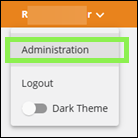

#### Units

The Units page lists all the units in Blueprint. A unit is an organizational entity, such as a team, department, or agency, that groups users for exercise purposes. Administrators can add, edit, and delete units, and assign users to their respective units.

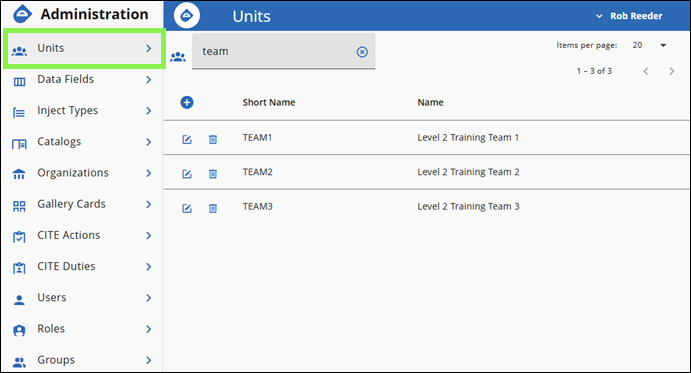

##### Add a Unit

1. Expand the dropdown next to your username in the top-right corner and select **Administration**.
2. Under **Units**, click **+** (**Add Unit**).
3. In **Name**, enter the unit name (for example, `Carnegie Mellon University`).
4. In **Short Name**, enter a short name or acronym (for example, `CMU`).
5. Click **Save**.

##### Edit, Delete, and Search for a Unit

- **Edit:** Click **Edit** (pencil icon) next to the unit, make the desired changes, and click **Save**.
- **Delete:** Click **Delete** (trash can icon) next to the unit.
- **Search:** In the **Search** field, enter the name of the unit.

##### Add/Remove Users from a Unit

To add a user to a unit:

1. Click the unit row to expand its configuration.
2. Under **All Users**, find the user and click **Add User**.

To remove a user from a unit, under **Unit Users**, find the user and click **Remove**.

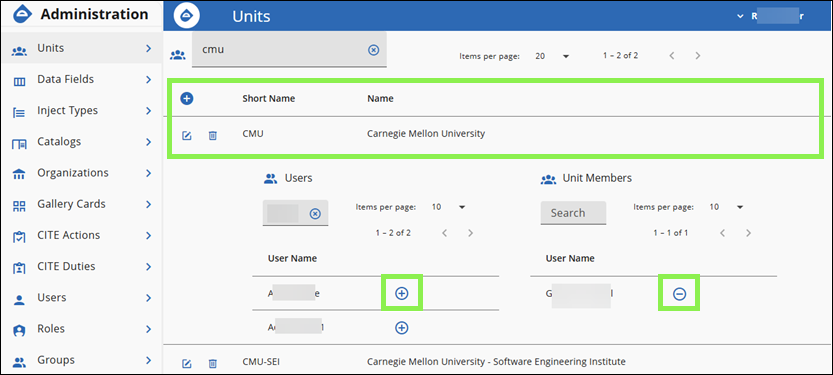

#### Data Fields

The Data Fields page lists all data field templates available for use in MSEL scenario events. Data fields define the columns that appear on a MSEL - similar to column headers in a spreadsheet. The **Info** and **Facil** checkboxes control whether the field displays for information events and facilitation events, respectively. Content developers can pull these templates into a MSEL from the **Data Fields** tab.

##### Add a Data Field Template

1. Under **Data Fields**, click **+** (**Add a template data field**).
2. In **Name**, enter the field name (for example, `Delivery Method`).
3. In **Data Type**, select the data type. Available types: Boolean, Card, Checkbox, Competency, Datetime, Double, HTML, Integer, IpAddress, Move, Network, Organization, SourceType, Status, String, Team, TeamsMultiple, Url, User. See [Data Value Checks](#data-value-checks) for the values IpAddress, Network, and Datetime fields accept.
4. Check **Use Option List** to provide a predefined list of selectable values for the field (for example, `Low, Medium, High`).
5. Click **Save**.

##### Edit, Delete, and Search for a Data Field Template

- **Edit:** Click **Edit** (pencil icon) next to the field, make the desired changes, and click **Save**.
- **Delete:** Click **Delete** (trash can icon) next to the field.
- **Search:** In the **Search** field, enter the name of the data field template.

#### Inject Types

The Inject Types page lists all inject type templates available for use in MSELs. An inject type defines the structure and data fields for a category of scenario events.

##### Add an Inject Type

1. Under **Inject Types**, click **+** (**Add Inject Type**).
2. In **Name**, enter the inject type name (for example, `Email`).
3. In **Description**, enter a brief description (for example, `Email-based scenario events`).
4. Click **Save**.

##### Edit, Delete, and Search for an Inject Type

- **Edit:** Click **Edit** (pencil icon) next to the inject type, make the desired changes, and click **Save**.
- **Delete:** Click **Delete** (trash can icon) next to the inject type.
- **Search:** In the **Search** field, enter the name of the inject type.

#### Catalogs

The Catalogs page lists all catalog templates available for use in MSELs. A catalog is a reusable collection of scenario events associated with a specific inject type.

##### Add a Catalog

1. Under **Catalogs**, click **+** (**Add Catalog**).
2. In **Name**, enter the catalog name.
3. In **Description**, enter a brief description.
4. In **Inject Type**, select the inject type for this catalog.
5. Check **Is a Public Catalog** to make the catalog available to all users.
6. Under **Data Fields to Show on Inject List**, check the fields to display.
7. Click **Save**.

##### Edit, Delete, and Search for a Catalog

- **Edit:** Click **Edit** (pencil icon) next to the catalog, make the desired changes, and click **Save**.
- **Delete:** Click **Delete** (trash can icon) next to the catalog.
- **Search:** In the **Search** field, enter the name of the catalog.

#### Organizations

The Organizations page lists all organization templates available for use in MSELs. An organization template defines a reusable entity  -  such as a government agency, company, or media outlet  -  that can be added to MSEL events. Content developers can pull these templates into a MSEL from the **Organizations** tab.

##### Add an Organization Template

1. Under **Organizations**, click **+** (**Add Organization Template**).
2. In **Long Name**, enter the full organization name (for example, `Cybersecurity and Infrastructure Security Agency`).
3. In **Short Name**, enter a short name or acronym (for example, `CISA`).
4. In **Summary**, enter a brief description (for example, `Security agency`).
5. In **Email**, enter the organization's email address (for example, `john@cisa.gov`).
6. In **Description**, enter the full organization description.
7. Click **Save**.

##### Edit, Delete, and Search for an Organization Template

- **Edit:** Click **Edit** (pencil icon) next to the organization template, make the desired changes, and click **Save**.
- **Delete:** Click **Delete** (trash can icon) next to the organization template.
- **Search:** In the **Search** field, enter the name of the organization template.

#### Gallery Cards

The Gallery Cards page lists all Gallery card templates available for use in MSELs. A Gallery card template defines a reusable card category that can be pushed to Gallery during an exercise. Content developers can pull these templates into a MSEL from the **Gallery Cards** tab.

##### Add a Gallery Card Template

1. Under **Gallery Cards**, click **+** (**Add Gallery Card Template**).
2. In **Name**, enter the card name (for example, `Information Technology Sector`).
3. In **Card Description**, enter a brief description (for example, `Status of the Information Technology Sector`).
4. Click **Save**.

##### Edit, Delete, and Search for a Gallery Card Template

- **Edit:** Click **Edit** (pencil icon) next to the card template, make the desired changes, and click **Save**.
- **Delete:** Click **Delete** (trash can icon) next to the card template.
- **Search:** In the **Search** field, enter the name of the card template.

#### CITE Actions

The CITE Actions page lists all CITE action templates available for use in MSELs. A CITE action template defines a reusable task that teams complete during an exercise. Content developers can pull these templates into a MSEL from the **CITE Actions** tab.

##### Add a CITE Action Template

1. Under **CITE Actions**, click **+** (**Add CITE Action Template**).
2. In **Description of the Action**, enter the action description (for example, `Score the incident`).
3. Click **Save**.

##### Edit, Delete, and Search for a CITE Action Template

- **Edit:** Click **Edit** (pencil icon) next to the action template, make the desired changes, and click **Save**.
- **Delete:** Click **Delete** (trash can icon) next to the action template.
- **Search:** In the **Search** field, enter the name of the action template.

#### CITE Duties

The CITE Duties page lists all CITE duty templates available for use in MSELs. A CITE duty template defines a reusable role or responsibility assigned to team members during an exercise. Content developers can pull these templates into a MSEL from the [CITE Roles](#cite-roles) tab.

##### Add a CITE Duty Template

1. Under **CITE Duties**, click **+** (**Add CITE Duty Template**).
2. In **Name**, enter the duty name (for example, `Reviewer`).
3. Click **Save**.

##### Edit, Delete, and Search for a CITE Duty Template

- **Edit:** Click **Edit** (pencil icon) next to the duty template, make the desired changes, and click **Save**.
- **Delete:** Click **Delete** (trash can icon) next to the duty template.
- **Search:** In the **Search** field, enter the name of the duty template.

#### Users

The following image shows the Users Administration Page. Here, administrators can add and delete users. Additionally, administrators can assign the necessary permissions to each user.

The available permissions are:

- **System Admin:** Can use all administration privileges on the Blueprint application.
- **Content Developer:** Can view, edit, create, and approve events on the MSEL.

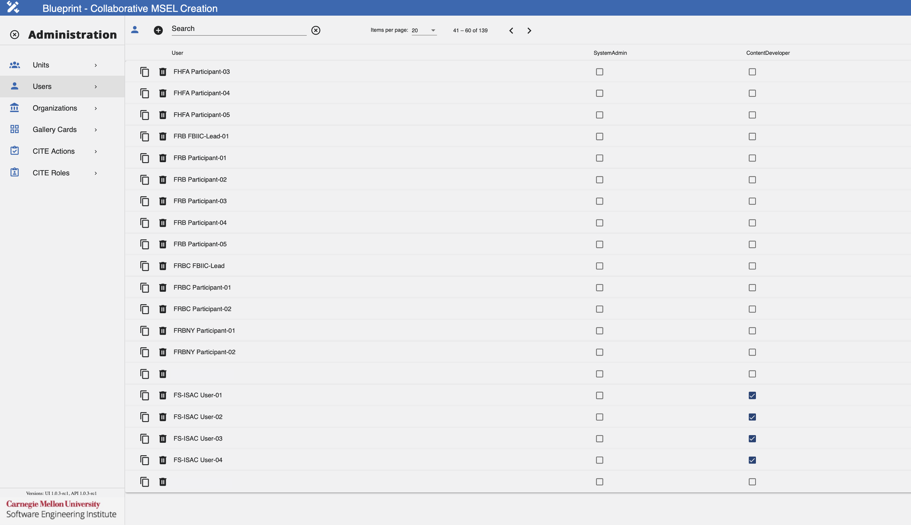

##### Add a User

If the exercise administrator has granted the appropriate permissions, follow these steps to add a user.


1. Under the Users Administration View, click **+**.
2. Fill the fields as necessary following the Data Format Table specifications.

##### Data Format Table

| Field         | Data Type | Description            | Example                              |
| ------------- | --------- | ---------------------- | ------------------------------------ |
| **User ID**   | GUID      | Unique ID for the user | 9dd4e3d8-5098-4b0a-9216-697cda5553f8 |
| **User Name** | String    | User name identifier   | user-2                               |

Click the **Save** icon (a user with a **+** sign), then select the permissions you want to assign by checking the boxes next to the user's name.

##### Delete a User

To delete a user, follow these steps:

1. Click the **Gear** icon in the top-right corner.
2. Under the Users Administration View, select the user you want to delete and click the **Trash Can** next to the user.

##### Search for a User

To search for a specific user, follow these steps:

1. Click the **Gear** icon in the top-right corner.
2. Under the Users Administration View, click the **Search Bar** and type the name of the desired user.

#### Roles

<!-- TODO: Document Roles administration page -->

#### Groups

<!-- TODO: Document Groups administration page -->

## User Guide

Content developers use Blueprint to build and manage MSELs.

### Event Dashboard

The **Event Dashboard** is Blueprint's homepage. It shows a card for each thing the current user can do: **Join**, **Launch**, **Build**, and **Assess**. Each card shows how many events it applies to. While data loads, an **Initializing Data** card is displayed with a progress spinner.

Below the mission cards, four cards describe what Blueprint does: **Collaborative Planning**, **Integrated Platform**, **Scenario Design**, and **Cyber Range Ready**. Click one to read more.

#### Join an Event

The **Join** card (*Active Exercises*) counts the in-progress events the user can join. Click **Join Event** to go to `/join`, which shows a card for each of those events with its name and description. Click **Join** on a card to open the event in Player. **Join** is a link, so it can also be opened in a new tab. When there is nothing to join, the card shows **No active events available to join** and cannot be clicked.

#### Start an Event

If the user can launch any template MSELs, the **Launch** card (*Initiate New Missions*) is shown. Click **Start Event** to go to `/launch` and choose a template to launch. Launching the event creates its teams in a new Player view and proceeds to Player.

#### Manage an Event

If the user holds the `CreateMsels` permission or is a contributor on any MSEL, the **Build** card (*Design & Planning*) is shown. Click **Manage Events** to go to `/build`, where the user can create, edit, delete, and open MSELs.

#### Assess an Event

If the user is a System Admin or an Evaluator on any MSEL, the **Assess** card (*Evaluation & Scoring*) is shown, with the number of those MSELs that have scenario events. Evaluators open a MSEL's [Assessor View](#assessor-view) from its **Assessor View URL**.

If the user can do none of these, a single **No Access** card is shown instead.

### Player Manage Event Page

!!! note

    Most invitation management now happens directly from the MSEL's [Invitations](#invitations) tab in Blueprint. The Player Manage Event application described below is still used by participants after a launched event is running, but MSEL owners typically create and manage invitations in Blueprint before launch.

When a user starts an event (as described above), Blueprint adds a **Manage Event** application to the left side panel of the Player view. The Manage Event application lets the user change the event end time, end the event, and invite others to join.

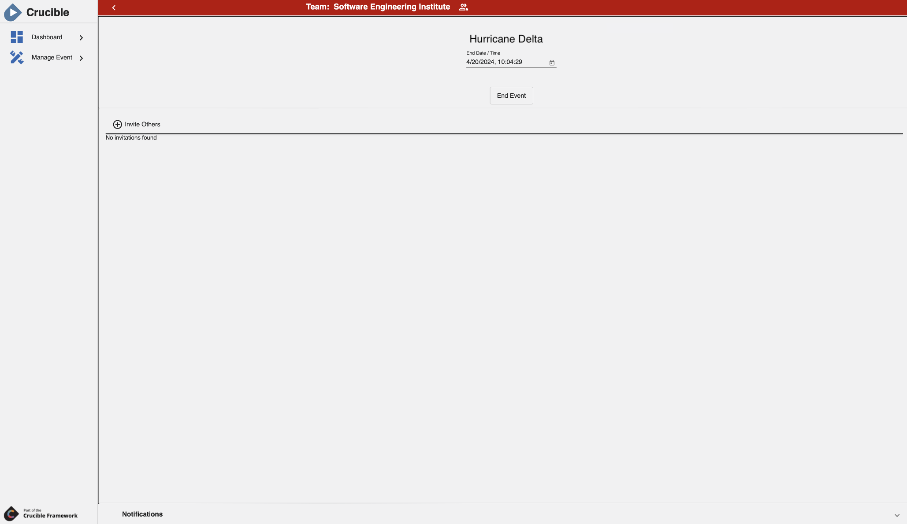

#### Launched Event User Invitations

To invite other users to the launched event, follow these steps:

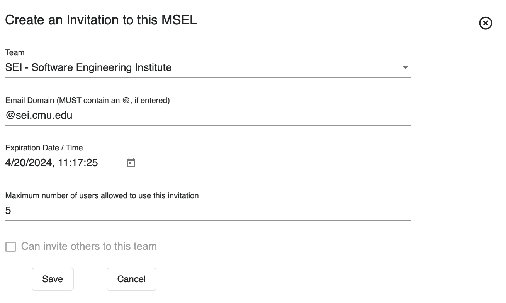

1. Navigate to the **Manage Event** application from Player's side panel.
2. Click **Invite Others**.
3. Fill the fields as necessary following the Data Format Table specifications.

#### Data Format Table

| Field                                                      | Data Type     | Description                                       | Example                              |
| ---------------------------------------------------------- | ------------- | ------------------------------------------------- | ------------------------------------ |
| **Team**                                                   | Dropdown Text | User's team                                       | SEI - Software Engineering Institute |
| **Email Domain**                                           | String        | User's email domain tied to the invitation        | @sei.cmu.edu                         |
| **Expiration Date/Time**                                   | Datetime      | Date/Time when the invitation should expire       | 04/20/2024 11:17:25                  |
| **Maximum Number of Users Allowed to Use this Invitation** | Integer       | Number of users allowed to use the invitation     | 5                                    |
| **Can Invite Others to this team**                         | Boolean       | Allows new users to invite others to the exercise | False                                |

After you've added all desired configurations, click **Save**.

#### Ending a Launched Event

To end an event, follow these steps:

1. Navigate to the **Manage Event** application from Player's side panel.
2. Click **End Event**.
3. On the confirmation screen, click **Yes** to successfully end the event.

### MSEL Catalog

The MSEL Catalog shows created MSELs. Users can select a MSEL to work on, create a new one, and delete an existing one.

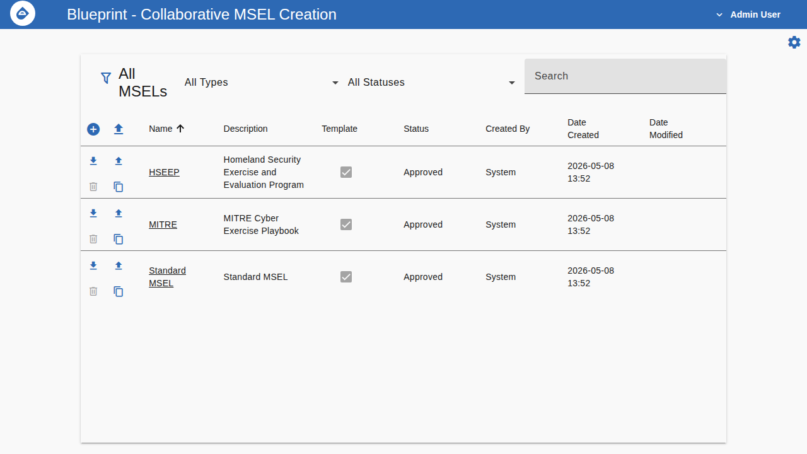

#### Create or Upload a MSEL

Two actions are available in the MSEL list table header:

- **Add blank MSEL** (**+** icon): creates a new MSEL with default settings. The new MSEL appears with status `Pending` and a description such as "Created from Default Settings by [username]".
- **Upload a new MSEL from a file** (upload icon): choose **Upload xlsx file** or **Upload JSON file**, then select the file to create a new MSEL from its contents. A `.json` file is one exported with **Download JSON file** from a MSEL's row actions.

##### JSON Import Report

After a JSON upload, Blueprint shows a report for the imported MSEL:

- **Imported:** the number of **Moves**, **Scenario Events**, **Cards**, **Teams**, **Data Fields**, and **Pages** created.
- **Changed:** what Blueprint adjusted to fit this Blueprint, such as a new name when a MSEL with the file's name already exists, a CITE scoring model or team type linked by name, team members that could not be imported, and which integrations are on.
- **Failed:** steps that could not be completed, such as checking the scoring model in CITE, with what to do before pushing.

Click **Open MSEL** to open the new MSEL, or **Close** to stay on the MSEL list.

#### Draft a MSEL with AI

When AI drafting is on, you can draft a whole MSEL from a description of the exercise. The draft follows an exercise design workflow: the scenario first, then the training objectives, then the moves and the injects that drive them. You need the `CreateMsels` permission.

Drafting has two steps. First the model writes the design, with a few questions for you. You review and change the design, answer the questions, and click **Create MSEL**. Blueprint creates the MSEL at once and then writes the injects, Gallery articles, and profiles into it, step by step, while you watch on the MSEL's page.

1. In the MSEL list table header, click **Draft MSEL with AI**.
2. In **Template**, choose the template to draft from. The draft uses the template's columns, teams, organizations, Gallery cards, and integrations. With several templates, **Crucible MSEL** is chosen to start with.
3. Optionally, in **Competency frameworks**, choose the frameworks whose competencies the draft may assign. With none chosen, the draft uses the template's own competencies.
4. In **Exercise description**, describe the audience, the scenario, the objectives, the organizations to simulate, and the competencies to exercise.
5. Optionally, expand **Design choices (optional)** and answer the questions that change an exercise most. The draft decides any you leave open and says what it chose.
    - **Format:** a discussion-based tabletop, a functional exercise with hands-on work in the range, or a hybrid.
    - **CITE assessment:** how CITE assesses the teams. See [CITE Assessment Choices](#cite-assessment-choices). This appears only when the template uses CITE.
    - **Gallery cards:** how the articles are grouped on the Gallery wall: by source or thread, by organization, by critical infrastructure sector, by country, or by network segment and key cyber terrain. This appears only when the template uses Gallery.
    - **Number of moves**, **Length (minutes)**, and **Scenario time covered:** the pacing. The scenario time covered is how much story time the exercise spans, such as `three days`.
    - **Doors open before STARTEX (minutes):** how long the pre-exercise move runs, for participants who arrive early. The default is `15`.
    - **Last move is a leadership brief:** whether the exercise ends with a brief to leadership.
    - **Participant structure:** how you organize participants, such as one combined staff or parallel national teams.
    - **Article marking:** the banner on every Gallery article. See [Article Markings](#article-markings). This appears only when the template uses Gallery.
    - **Add Team Profiles and Organization Profiles pages:** clear this to skip the profile pages.
6. Click **Draft**. Writing the design takes a minute or two. The dialog shows what the model has written so far and how long it has run. Click **Stop** to abandon it; your description stays.
7. Review the design in its tabs:
    - **Questions:** up to five questions whose answers change the exercise, each with a suggested answer and why it matters. Change any answer you disagree with; click **Use it** to put a suggestion back. The injects are written to your answers.
    - **Design:** the name, description, problem, premise, escalation ceiling, and the objectives as task, condition, and standard. The **Check before creating** list shows anything Blueprint corrected or the model assumed.
    - **Moves:** each move's start on the exercise clock, its scenario time, title, and purpose.
    - **Teams and organizations:** each one's short name, name, and description. For a CITE template, each team's **CITE duties**, which members pick from in CITE. Click the **X** to remove one.
    - **Gallery cards:** the cards on the Gallery wall.
8. Click **Create MSEL**. Click **Edit description** to change the description and draft again, or **Discard** to close without saving.

Blueprint creates the MSEL and opens it. A banner at the top of the MSEL's page shows each step as it is written: the outline of the injects, CITE tasks, and read-in, with the injects counted as the model writes them; then the text of each inject, each Gallery article, and each profile, several at once; then the pages, Player applications, and CITE. Everything is saved as it is written, so you can work on the MSEL, or leave it, while it builds. Click **Cancel** to stop.

A MSEL whose build stopped, after **Cancel**, an error, or a closed tab, shows **This MSEL is still being drafted with AI** on its page with what is left, and offers **Continue drafting**, which picks up from the last saved step, **Finish without them**, which skips the articles and profiles still to write, and **Discard draft**, which deletes the MSEL.

##### What Create MSEL Adds

Besides the moves, teams, organizations, Gallery cards, and injects, creating a drafted MSEL adds:

- **A pre-exercise move and a hot wash:** move 0 opens when the doors open and holds the read-in, so participants who arrive early have somewhere to wait. `STARTEX` opens move 1, the first move of play, and `ENDEX` opens the last move, the after-action hot wash. When the MSEL uses Steamfitter, each is a Steamfitter task that changes the move in CITE and Gallery.
- **Two clocks:** each move has a scenario time, which can jump ahead between moves. Blueprint dates each Gallery article within its move's scenario time.
- **An Expected Actions column:** what participants should do for each inject. It shows on the event list for controllers but not on the exercise view.
- **Pages:**
  - **Exercise Overview:** the objectives, teams and roles, schedule, and assessment. Every participant can see it.
  - **[MSEL name] Read-In:** the read-in. Every participant can see it.
  - **Facilitator Guide:** each move's purpose, expected decisions, controller notes, and questions; the expected action and objective of every inject; and the after-action review. Participants cannot see it.
  - **Team Profiles** and **Organization Profiles:** each team's and organization's profile, unless you cleared the option.
- **Player applications**, when the MSEL uses Player: **CITE Dashboard**, **Gallery Wall**, **Gallery Archive**, **Read-In**, the profile pages, and **Exercise Timeline** for every team, and the Steamfitter applications for exercise control. The template's **Virtual Machines** application, and a map on it, stay only when the MSEL uses Caster and the format is functional or hybrid, because a tabletop's teams have no machines.
- **CITE**, when the MSEL uses CITE: each team gets one of CITE's built-in team types (**Official Score Contributor** for participant teams, **Other** for `EXCON`), its CITE duties, the CITE tasks, and the scoring model you chose, authored into the MSEL.
- **Steamfitter**, when the MSEL uses Steamfitter: `STARTEX` and `ENDEX` rows, each with a Player notification to every participant.
- **Exercise control:** your units become contributors, you join the exercise control team, and you become a CITE facilitator and a Gallery observer, so exercise control can watch every team. Every team sees every Gallery card; exercise control can post to them.
- **Catalog metadata:** the Institute of Electrical and Electronics Engineers (IEEE) 2881 fields on the **Info** tab: difficulty, purpose, mode, subject, keywords, and language.
- **A picture:** when the server has an image model, the MSEL gets a picture made from its scenario.
- **Article markings:** the banner you chose on every Gallery article. See [Article Markings](#article-markings).

When you push the integrations, Gallery gets the drafted articles. Pages and articles sit on white paper with dark text, so they read the same in light and dark themes.

##### CITE Assessment Choices

- **Keep the template's scoring model:** offered, and chosen by default, when the template already links a scoring model.
- **Questions by move:** the draft writes discussion questions for each move. The MSEL gets its own scoring model, `[MSEL name] Questions by Move`: one category per move of play with the move's questions, comment boxes on, and scores hidden, and a final category in the hot wash for the after-action review.
- **DoD CTT mission impact matrix:** teams score the mission impact of each move, following the Department of Defense Cyber Table Top (CTT) guide. The MSEL gets its own copy of the `DoD CTT Mission Impact Assessment` model.
- **DoD CTT likelihood matrix:** teams score each attack's cost and chance of success. The MSEL gets its own copy of the `DoD CTT Likelihood Assessment Matrix` model, with the matrix beside the score sheet.
- **CISA NCISS:** each move, teams score the incident with the Cybersecurity and Infrastructure Security Agency (CISA) National Cyber Incident Scoring System (NCISS): functional impact, observed activity, location of observed activity, actor characterization, information impact, how recoverable the systems are, cross-sector dependency, and potential impact. The MSEL gets its own copy of the `CISA NCISS` model.
- **None:** no scoring model.

The model is authored in Blueprint, not created in CITE: review and edit it under the CITE settings on the **Info** tab, where **Author it in Blueprint** is selected. The push creates it in CITE for the evaluation, so a draft you discard leaves nothing in CITE. A template that authors its own model hands every MSEL drafted from it a copy, which the draft keeps.

##### Article Markings

Blueprint puts a marking banner on every Gallery article it writes, so the marking is exact and the same on every article. Choose it in **Design choices** when drafting, or on the **Info** tab under the Gallery settings as **Article marking**:

- **Exercise banner:** the default: `EXERCISE · EXERCISE · EXERCISE` with the exercise name and `FICTIONAL SCENARIO`.
- **TLP:** a Traffic Light Protocol (TLP) marking at the top, in the level's color: `CLEAR`, `GREEN`, `AMBER`, `AMBER+STRICT`, or `RED`.
- **Classification banner:** your own text, such as `UNCLASSIFIED // FOR EXERCISE USE ONLY`, at the top and bottom, in the color of the level it names.
- **None:** no banner.

Articles already written keep their banner until Write with AI rewrites them.

#### Filter Display

Use the filter options to narrow down MSELs shown in the catalog.

##### Types

Filter MSELs by categorization. Options are: All Types, Templates, and Not Templates.

##### Statuses

Filter MSELs by current status. Options are: `All Statuses`, `Pending`, `Entered`, `Approved`, `Deployed`, and `Completed`.

!!! note

    The filter dropdown uses `Completed` (past tense). The MSEL Status dropdown on the Config tab (see [Basic Information](#basic-information)) uses `Complete` and also exposes `Archived`. Both names refer to the same lifecycle state; the filter simply does not expose Archived MSELs by default.

##### Search

Search for a specific MSEL by name.

The MSEL list header also exposes:

- **Show only MSELs I own or have access to** toggle (funnel icon with subtitle **All MSELs** / **My MSELs**): for admins, switches between viewing every MSEL and only MSELs the user owns or contributes to.
- **Administration** gear: opens the Administration View (see [Administrator Guide](#administrator-guide)).

#### MSEL Row Actions

Each MSEL row in the catalog exposes four icon buttons in the first column:

- **Download** (down-arrow icon): choose **Download xlsx file** or **Download JSON file** to export the MSEL. A `.json` export can be uploaded again with **Upload JSON file**.
- **Upload .xlsx file to [MSEL name]** (up-arrow icon): replaces the MSEL's contents with data from the chosen file.
- **Delete [MSEL name]** (trash can icon): permanently removes the MSEL and its associated data. Template MSELs cannot be deleted; the trash can is disabled for them.
- **Copy [MSEL name]** (copy icon): duplicates the MSEL into a new, editable copy.

Click the MSEL's name (a link in the Name column) to open it for editing.

!!! important

    When importing MSELs into Blueprint, verify that events and settings align with your preferences. Some fields may require reconfiguration after import.

### MSEL Definition

After uploading or creating a MSEL, users can edit any information and add additional information to the MSEL. Users edit the same MSEL, instead of working on separate copies and sending edits to one person. This ensures everyone has the same version during the live scenario.

#### Change a MSEL with AI

When AI drafting is on, you can change a MSEL by describing what you want.

1. At the top of the MSEL, click **Ask AI**.
2. In **What should change?**, describe the change, such as `Split BLUE into a CERT team and a legal team`. You can also click one of the examples.
3. Click **Ask**. The assistant proposes changes, or asks you a question.
4. Clear the check box beside any change you do not want.
5. Click **Apply** to make the checked changes. The button shows how many changes it applies.

The assistant can add or edit teams, organizations, Gallery cards, moves and their scenario times, and injects, and add or remove competencies. It offers only the changes your MSEL role allows. It cannot delete injects or moves, or change data fields, integrations, users, or pages.

##### AI Usage

Blueprint records every call to an AI model made for a MSEL, including the calls that wrote its draft. The MSEL's owner, and users with the `ViewMsels` permission, see an **AI usage** table at the end of the **Config** section of the **Info** tab. It lists each step, such as **Design**, **Inject outline, CITE tasks and read-in**, **Inject text**, **Gallery articles**, **Ask AI**, and **News photos**, with its calls, input and output tokens, photos, and estimated cost. The estimate uses the prices in `Ai:Prices`; it totals the calls whose models have a price and names the models that have none. It includes calls the model declined, because the provider bills those too.

To write one value with AI:

1. Open a scenario event, and click **Write [field name] with AI** beside a text field.
2. Describe what you want, and click **Write**.
3. Click **Use this**, **Try again**, or **Discard**.

To write a profile with a logo, edit a team or an organization, and click **Write the team's profile with AI** or **Write the organization's profile with AI**.

#### Basic Information

On this tab, users can edit and configure MSEL settings, as well as enable/disable integrations.

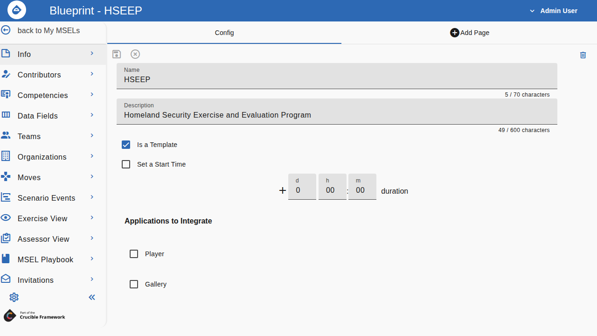

To edit the MSEL's basic information and configuration, follow these steps:

1. Navigate to the **Info** tab.
2. Ensure you are in the **Config** section.
3. Fill the fields as necessary following the Data Format Table specifications.

#### Data Format Table

| Field | Data Type | Description | Example |
| --- | --- | --- | --- |
| **Name** | String (max 70 characters) | Name of the MSEL | `Hurricane Delta MSEL` |
| **Description** | String (max 600 characters) | Details and/or characteristics of the MSEL | `Hurricane Delta Fort Myers Scenario` |
| **Is a Template** | Boolean | Marks this MSEL as a reusable template for creating new MSELs. Template MSELs cannot be deleted. | `True` |
| **Set a Start Time** | Boolean | When checked, exposes a **Start Date / Time** picker and schedules a specific start moment for the MSEL. When unchecked, the MSEL is open-ended. | `True` |
| **Start Date / Time** | Datetime | Start date/time of the MSEL (only visible when **Set a Start Time** is checked). | `09/10/2024 20:00:00` |
| **Duration (d / h / m)** | Integer × 3 | End time relative to the start, expressed as days / hours / minutes. Click **+** to increment or type directly into each field. | `1 d 12 h 00 m` |
| **Applications to Integrate** | Boolean checkboxes | Enable any of: Player, Gallery, CITE, Steamfitter, Caster. Enabling an integration activates additional MSEL sidebar tabs for that app. Caster requires Player. | Player: `True`, CITE: `True` |
| **MSEL Status** | Dropdown | MSEL lifecycle state: `Pending`, `Entered`, `Approved`, `Complete`, `Archived`. Blueprint sets `Pushing` and `Pulling` itself while it pushes or removes integrations, and `Deployed` once they are pushed; while the MSEL is in one of those, the dropdown is locked. | `Approved` |
| **Header Row Metadata (Height)** | Integer | Height of the header row when exporting this MSEL to `.xlsx`. | `30` |
| **Difficulty Rating** | Dropdown | Metadata tag describing the exercise's difficulty. | (per framework) |
| **Exercise Purpose** | Dropdown | Metadata tag describing why the exercise is being run. | (per framework) |
| **Exercise Mode** | Dropdown | Metadata tag describing how the exercise is delivered. | (per framework) |
| **Subject** | String | Free-text subject tags. | `incident response, network defense` |
| **Keywords** | String | Searchable keyword tags. | `ransomware, financial services` |
| **Date Created** | Date (read-only) | Date this MSEL was first saved. | `2026-05-08` |
| **Created By** | String (read-only) | Name of the user who created this MSEL. | `Admin User` |

To save Config-tab changes, click **Save Changes** at the top of the tab. **Cancel Changes** reverts unsaved edits. Both buttons are disabled until a change is made.

#### Direct-Access URLs

The Config tab exposes three copyable, shareable URLs. Each row shows a **Copy** (clipboard) button and a direct link.

- **Exercise View URL** (`http://<host>/msel/{mselId}/view`): use this URL for direct read-only access to the Exercise MSEL (see [Exercise View](#exercise-view)).
- **MSEL Starter URL** (`http://<host>/starter/?msel={mselId}`): use this URL for direct access to edit the Scenario Events list in starter mode.
- **Assessor View URL** (`http://<host>/assess/?msel={mselId}`): use this URL for direct access to the Assessor View (see [Assessor View](#assessor-view)).

#### Associating Competencies with a MSEL

The Config tab includes a **Competencies** row that points the user at the MSEL's [Competencies](#competencies) tab, where a competency framework can be attached to the MSEL.

#### Metadata

The **Metadata** block on the Config tab captures non-functional descriptors that help with searching and filtering MSEL catalogs: **Difficulty Rating**, **Exercise Purpose**, **Exercise Mode**, **Subject** (free text), and **Keywords** (free text).

#### Integrations

- **[Gallery](#glossary):** Blueprint will add the collections, exhibits, cards, articles, teams, and users specified on the MSEL. To learn more about this integration, reference the [Gallery](#gallery) section.
- **[CITE](#glossary):** Blueprint will add the evaluation, moves, actions, roles, teams, and users specified on the MSEL. To learn more about this integration, reference the [CITE](#cite) section.
- **[Player](#glossary) & [Steamfitter](#glossary):** Blueprint will automate the adding of events specified on the MSEL, as well as configure exercise details in Player.
- **[Caster](#glossary):** Blueprint will deploy the MSEL's virtual machine topology from a Caster directory into a new Caster workspace, with the VMs added to the Player view and its teams. To learn more about this integration, reference the [Caster](#caster) section.

#### MSEL Pages

Beyond the **Config** section, the **Info** tab is a container for user-authored notes pages. Click **Add Page** on the Info tab to create a new page; each page can be restricted to elevated users or exposed to every MSEL user.

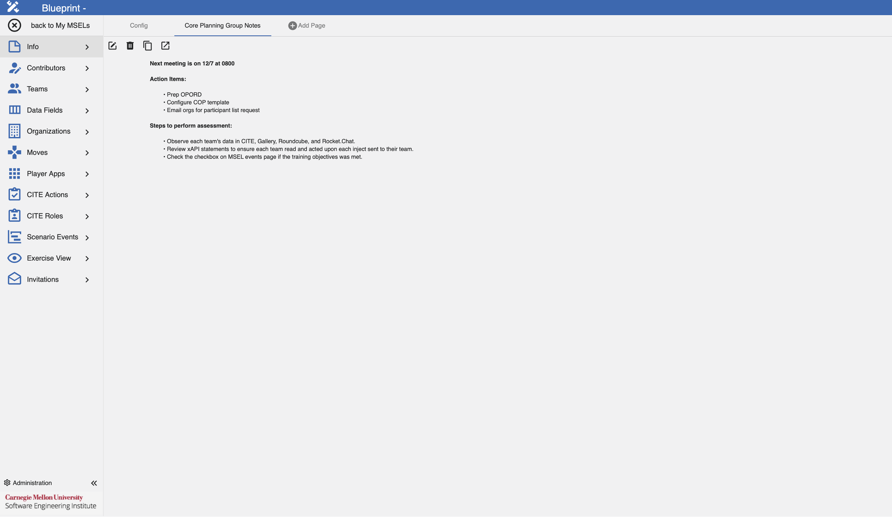

To add MSEL notes, follow these steps:

1. Navigate to the **Info** tab.
2. Click **Add Page**.
3. Fill the fields as necessary following the Data Format Table specifications.

#### Data Format Table

| Field                                 | Data Type | Description                                                                | Example                         |
| ------------------------------------- | --------- | -------------------------------------------------------------------------- | ------------------------------- |
| **Page Name**                         | String    | Name of the Page                                                           | Core Planning Group Notes       |
| **All MSEL users can view this page** | Boolean   | Enable other users who don't have elevated permissions to access this page | True                            |
| **Notes**                             | Rich Text | Field to add page notes                                                    | Next meeting is on 12/7 at 0800 |

After you've made your changes, click the **checkmark** to save the page.

#### Contributors

On this tab, users can add and assign contributor teams, as well as their respective roles related to the creation and management of the MSEL. Assigned teams can view and edit the MSEL.

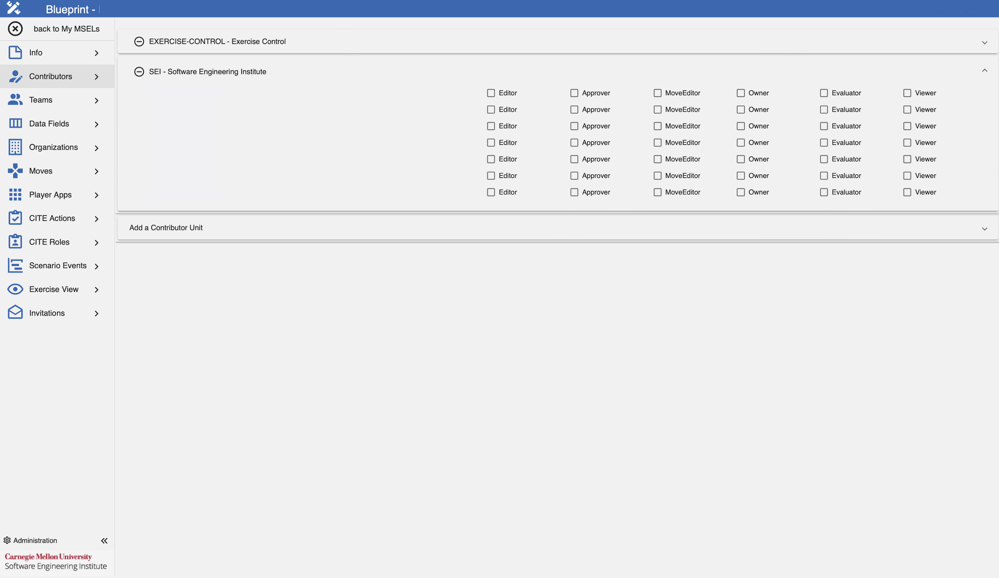

##### Add a Contributor

To add a contributor unit to the MSEL, follow these steps:

1. Navigate to the **Contributors** tab.
2. Click **Add a Contributor Unit**, then select the unit you want to add.
3. After selecting the unit, click the **+** button.

##### Remove a Contributor

To remove a contributor unit from the MSEL, follow these steps:

1. Navigate to the **Contributors** tab.
2. Select the team you want to remove and click the **-** button.

Now that you've added the unit to the MSEL, members can view and edit it based on each unit member's role.

The available roles are:

- **[`Editor`](#glossary):** Can edit the events assigned to them by the MSEL owner, but not other events. They cannot delete events or create new events.
- **[`Approver`](#glossary):** Can view and edit the MSEL, and will have the added feature of approving a MSEL.
- **[`Move Editor`](#glossary):** Can edit moves on the MSEL, as well as increment them during an exercise.
- **[`Owner`](#glossary):** Owner of the MSEL, can view and edit the MSEL, as well as perform all of the functionalities that the MSEL provides (e.g., Add Teams, Add Integrations, Events).
- **[`Evaluator`](#glossary):** Manages the exercise, can advance moves, execute events, and check events as completed.
- **[`Viewer`](#glossary):** Can view the MSEL, but can't edit it.

#### Competencies

On the **Competencies** tab, MSEL owners attach a competency framework (defined in the Administration Competencies page) and select which work roles, tasks, and specific knowledge, skills, and abilities apply to the MSEL. Selected competencies can then be associated with teams and scenario events, enabling assessment during the Assessor View.

##### Select a Competency Framework

1. Navigate to the **Competencies** tab.
2. In **Competency Framework**, select a framework from the dropdown. If no frameworks appear, define one in the Administration Competencies page.

##### Add Competencies to the MSEL

1. Expand the **Add Competencies** region.
2. Browse work roles and competencies from the selected framework and select the items that apply to this MSEL.

##### View MSEL Competencies

Expand the **MSEL Competencies** region to see the table of competencies associated with the MSEL. Columns include **ID**, **Type**, **Framework**, **Name**, **Teams**, and **Events**. Use the search box to filter by name.

#### Teams

On this tab, users can add and assign teams as well as their respective roles during an event to the MSEL.

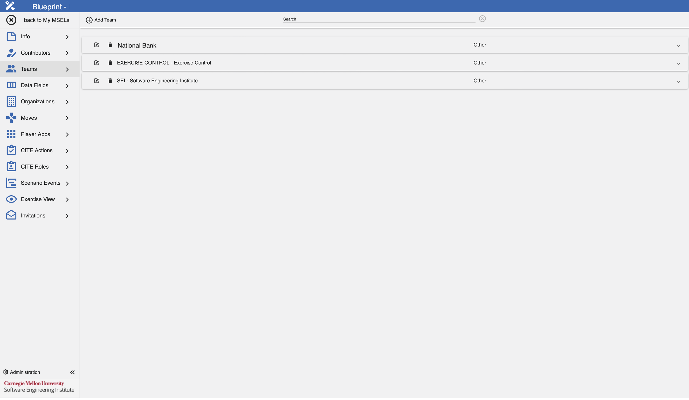

##### Add a Team

To add a team to the MSEL, follow these steps:

1. Navigate to the **Teams** tab.
2. Click **Add a Team**, then select the team you want to add.
3. After selecting the team, click the **+** button.

##### Remove a Team

To remove a team from the MSEL, follow these steps:

1. Navigate to the **Teams** tab.
2. Select the team you want to remove and click the **-** button.

Click a team to expand its **Team Members**. Each member's **Type** is their [CITE team role](#cite-team-roles), which decides what they can do in CITE. Check **Open Invite** on a team to let any of its members invite others to it.

#### Data Fields

On this tab, users can add data fields used on the MSEL. Compare these [data fields](#glossary) to the column fields on Excel spreadsheets.

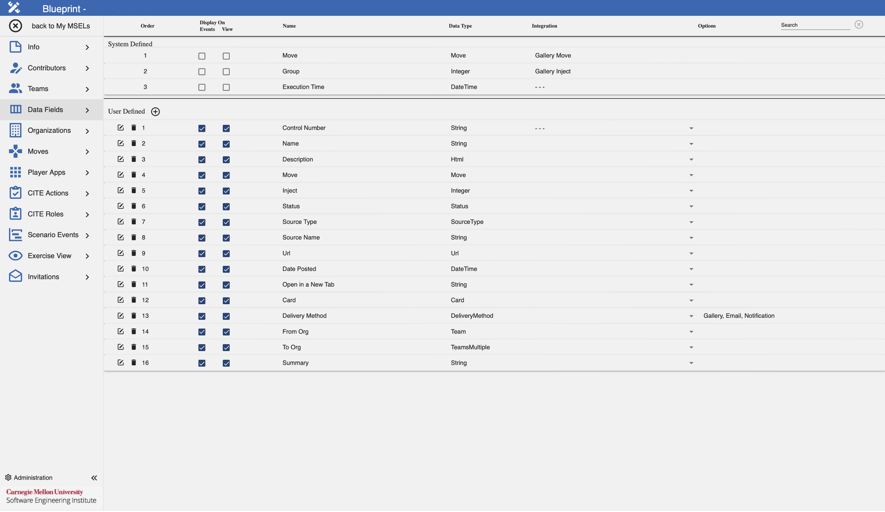

There are two categories of Data Fields:

- **[System Defined](#glossary):** Added by default in MSEL creation, since data fields under this category are essential for MSEL features to work.
- **[User Defined](#glossary):** Added by the user on an as-needed basis.

##### Add a Data Field

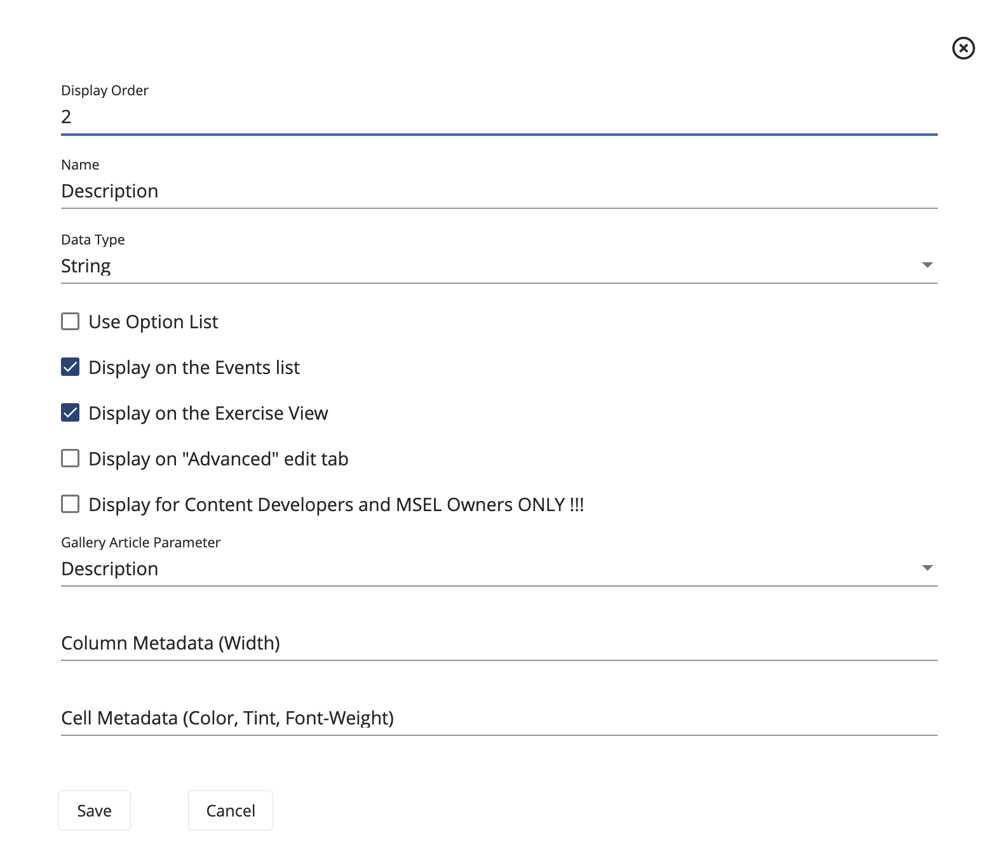

To add a Data Field to the MSEL, follow these steps:

1. Navigate to the **Data Fields** tab.
2. Click the **+** icon from the top left of the screen.
3. Fill the fields as necessary following the Data Format Table specifications.

#### Data Format Table

| Field                                                      | Data Type     | Description                                                                                    | Example          |
| ---------------------------------------------------------- | ------------- | ---------------------------------------------------------------------------------------------- | ---------------- |
| **Display Order**                                          | Integer       | Indicate the order of the data field                                                           | 1                |
| **Name**                                                   | String        | Name of the data field                                                                         | Description      |
| **Data Type**                                              | Dropdown Text | Data type for the data field                                                                   | String           |
| **Use Option List**                                        | Boolean       | Add options to select when adding an event                                                     | True             |
| **Multi-select**                                           | Boolean       | With **Use Option List**, allow more than one option to be selected                            | False            |
| **Display on the Events list**                             | Boolean       | Display this data field on the Events list tab                                                 | True             |
| **Display on the Exercise View**                           | Boolean       | Display this data field on the Exercise View tab                                               | True             |
| **Information Data Field**                                 | Boolean       | Display this data field for information events                                                 | True             |
| **Facilitation Data Field**                                | Boolean       | Display this data field for facilitation events                                                | True             |
| **Display on "Default" edit tab**                          | Boolean       | Display this data field on the Default tab of the event edit dialog                            | True             |
| **Assessor View**                                          | Boolean       | Display this data field on the [Assessor View](#assessor-view)                                 | True             |
| **Display for Content Developers and MSEL Owners Only!!!** | Boolean       | Display this data field for users who are Content Developers or MSEL Owners only               | True             |
| **Gallery Article Parameter**                              | Dropdown Text | If using the Gallery integration, select the Gallery parameter that aligns with the data field | Description      |
| **Column Metadata (Width)**                                | Integer       | Width of the column when displayed                                                             | 30               |
| **Cell Metadata (Color, Tint, Font-Weight)**               | String        | Column color and font style                                                                    | (Red, 20%, bold) |

After you've added all desired configurations, click **Save**.

##### Data Value Checks

Blueprint checks the values typed into these data field types. A value chosen from an option list is not checked.

| Data Type | Accepts | Example |
| --- | --- | --- |
| **IpAddress** | A single IPv4 or IPv6 address, without a prefix length | `192.0.2.10`, `2001:db8::10` |
| **Network** | A network in Classless Inter-Domain Routing (CIDR) form, with no host bits set. Blueprint suggests the corrected network when host bits are set. | `10.1.0.0/24`, `2001:db8::/48` |
| **Datetime** | A date and time chosen with the date picker | `09/10/2024 20:00:00` |

An event with a value that fails its check shows the problem under the field and cannot be saved until it is fixed. A Datetime value that is not a date, such as the text left behind when a field's type is changed to Datetime, is shown as is and marked **Not a date and time**. IpAddress and Network columns sort by address rather than alphabetically.

##### Delete a Data Field

To delete a Data Field from the MSEL, follow these steps:

1. Navigate to the **Data Fields** tab.
2. Select the data field you want to delete and click the **Trash Can**.

##### Edit a Data Field

To edit an existing Data Field, follow these steps:

1. Navigate to the **Data Fields** tab.
2. Select the data field you wish to edit and click **Edit** to make any changes to the existing configurations.
3. After making all necessary changes, click the **checkmark** to save them.

##### Search for a Data Field

To search for a specific Data Field, follow these steps:

1. Navigate to the **Data Fields** tab.
2. Click the **Search Bar** and add the name of the data field desired.

#### Organizations

On this tab, users add all related [organizations](#glossary) (with their information) used on the MSEL and the live exercise. Users can create organizations from scratch or from a template.

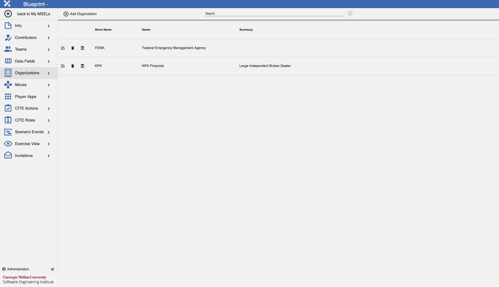

##### Add an Organization Card from Scratch

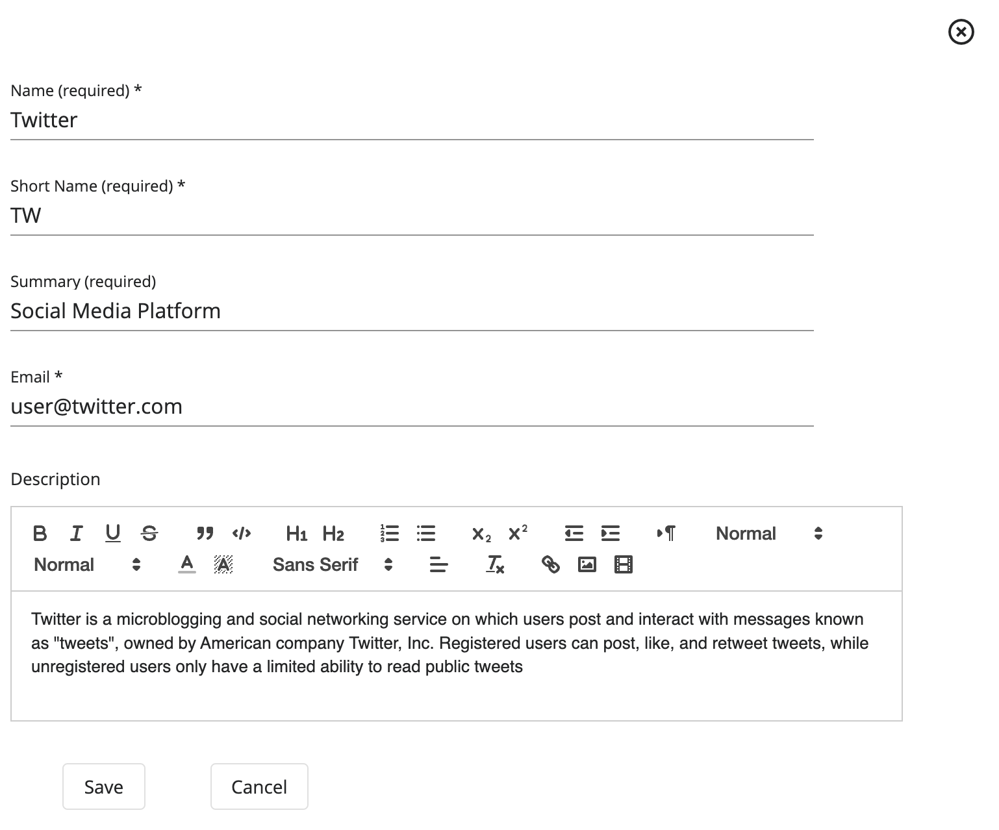

To add an Organization Card from scratch, follow these steps:

1. Navigate to the **Organizations** tab.
2. Click **Add Organization**.
3. Select **New Organization** from the dropdown.
4. Fill the fields as necessary following the Data Format Table specifications.

##### Data Format Table

| Field           | Data Type | Description                                                   | Example                                                                                                                                                             |
| --------------- | --------- | ------------------------------------------------------------- | ------------------------------------------------------------------------------------------------------------------------------------------------------------------- |
| **Name**        | String    | Name of the organization                                      | Twitter                                                                                                                                                             |
| **Short Name**  | String    | Organization's short name, such as an acronym                 | TW                                                                                                                                                                  |
| **Summary**     | String    | Organization's short summary                                  | Social media platform                                                                                                                                               |
| **Email**       | String    | Organization's email contact                                  | `user@twitter.com`                                                                                                                                                  |
| **Description** | Rich Text | Information, details, and characteristics of the organization | Twitter is a micro-blogging and social networking service on which users post and interact with messages known as "tweets", owned by American company Twitter, Inc. |

After you've added all desired configurations, click **Save**.

##### Add an Organization Card from Template

To create an organization from a template, follow these steps:

1. Navigate to the **Organizations** tab.
2. Click **Add Organization**.
3. Select the template you want to use from the dropdown.
4. Here, users can edit all necessary information to create a new organization.
5. After modifying the desired details, click **Save**.

##### Edit an Organization

To edit an existing organization, follow these steps:

1. Navigate to the **Organizations** tab.
2. Select the card you want to edit and click **Edit** next to the organization name.
3. Here, users can edit all necessary information.
4. Click **Save**.

##### Delete an Organization

To delete an organization, follow these steps:

1. Navigate to the **Organizations** tab.
2. Select the card you want to delete and click the **Trash Can** next to the organization name.

##### Search for an Organization

To search for a specific organization, follow these steps:

1. Navigate to the **Organizations** tab.
2. Click the **Search Bar** and type the name of the desired organization.

#### Moves

On this tab, users can add all related exercise [moves](#glossary) to the MSEL.

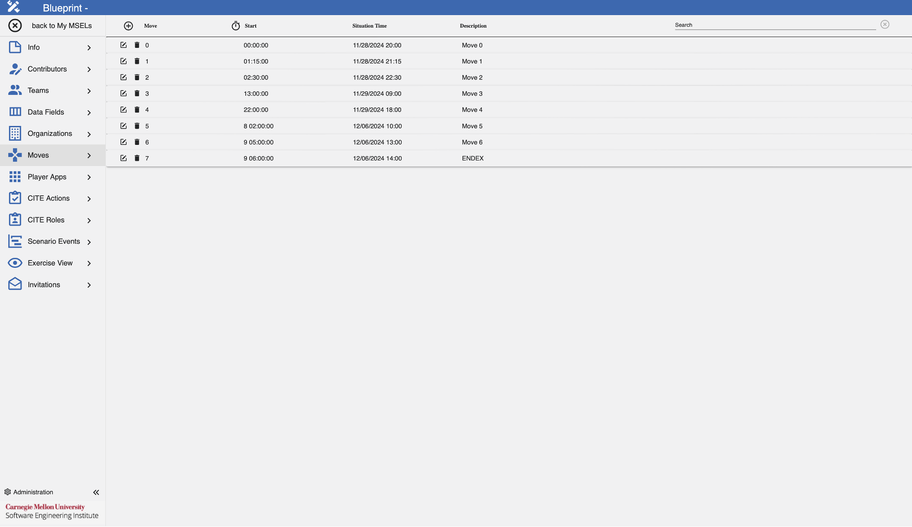

##### Add a Move

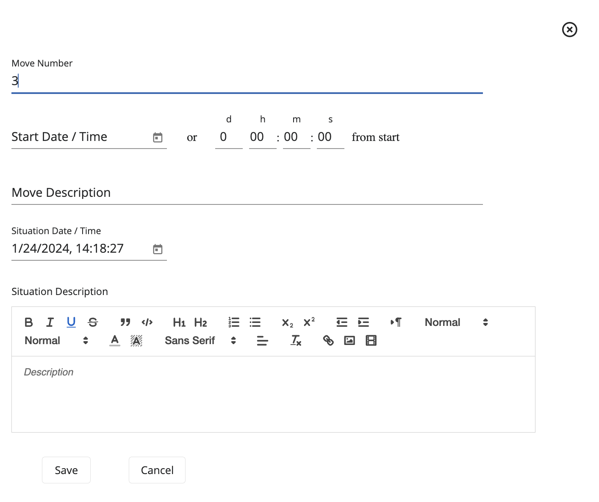

To add a move, follow these steps:

1. Navigate to the **Moves** tab.
2. Click the **+** icon.
3. Fill the fields as necessary following the Data Format Table specifications.

##### Data Format Table

| Field                     | Data Type | Description                                               | Example                                  |
| ------------------------- | --------- | --------------------------------------------------------- | ---------------------------------------- |
| **Move Number**           | Integer   | Designated number for the move                            | 1                                        |
| **Start Date/Time**       | Datetime  | Start date/time of the move real-time                     | 11/20/2023, 09:00:00                     |
| **Move Description**      | String    | Information, details, and characteristics of the move     | Scene Setter                             |
| **Situation Date/Time**   | Datetime  | Start date/time of the move exercise-time                 | 1/24/2024, 14:18:27                      |
| **Situation Description** | Rich Text | Information, details, and characteristics of the exercise | Hurricane Delta has landed in Fort Myers |

After you've added all desired configurations, click **Save**.

##### Edit a Move

To edit the move's details, follow these steps:

1. Navigate to the **Moves** tab.
2. Select the move you want to edit and click **Edit** for the corresponding move.
3. Here, users can edit all desired details.
4. Click **Save**.

##### Delete a Move

To delete a move from the MSEL, follow these steps:

1. Navigate to the **Moves** tab.
2. Select the move you want to delete and click the **Trash Can** for the corresponding move.

##### Search for a Move

To search for a specific move, follow these steps:

1. Navigate to the **Moves** tab.
2. Click the **Search Bar** and type the name of the desired move.

#### Scenario Events

On this tab, users can add all related events to the MSEL.

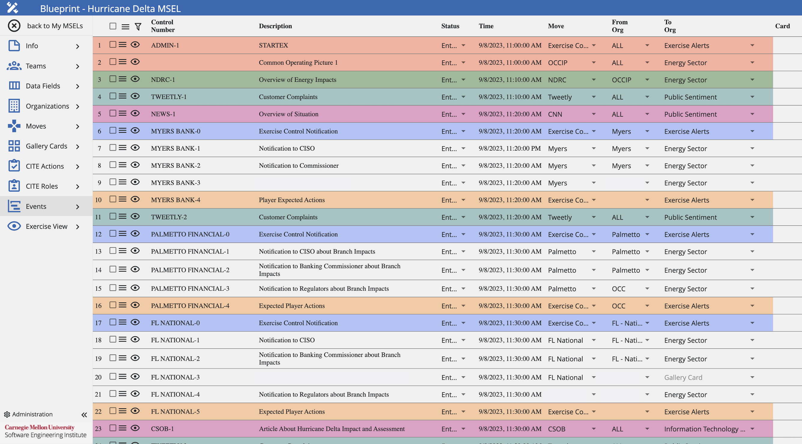

##### Add an Event

To add a new event, follow these steps:

1. Navigate to the **Events** tab.
2. Click the **Hamburger** icon found on the top left.
3. Click **Add New Event**.

On the **Default** tab, fill the fields as necessary following the Data Format Table specifications.

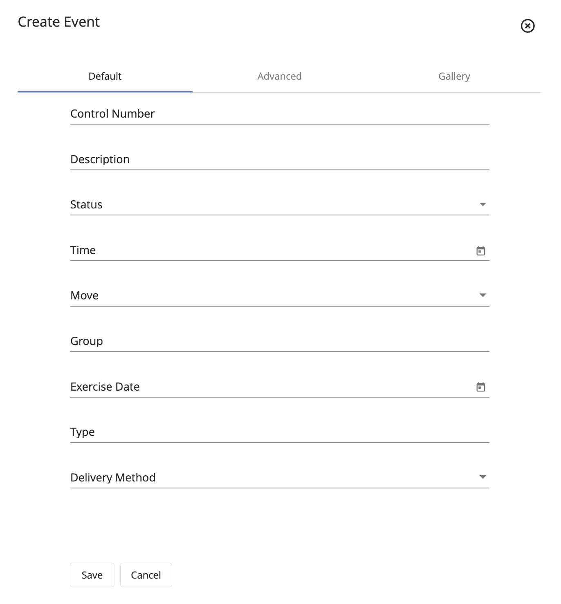

##### Data Format Table

| Field               | Data Type     | Description                                                                  | Example                |
| ------------------- | ------------- | ---------------------------------------------------------------------------- | ---------------------- |
| **Control Number**  | String        | Event control number, used to identify and categorize events                 | `ADMIN-1`              |
| **Description**     | String        | Information, details, and characteristics of the event                       | `STARTEX`              |
| **Status**          | Dropdown Text | Approval status of the event used on the MSEL                                | `Approved`             |
| **Time**            | Datetime      | Start date/time of the move real-time                                        | `11/20/2023, 09:00:00` |
| **Move**            | Dropdown Text | Move number the event is part of                                             | `1`                    |
| **Group**           | Integer       | Groups events within a move, often times executed within the same time range | `1`                    |
| **Exercise Date**   | Datetime      | Start date/time of the move exercise-time                                    | `1/24/2024, 14:18:27`  |
| **Type**            | String        | Source type for the event                                                    | `Email`                |
| **Delivery Method** | Dropdown Text | How is the event delivered to participants                                   | `Email`                |

If not already completed on the previous tab, fill the fields from the **Advanced** tab following the Data Format Table specifications. This tab focuses on the MSEL's metadata and style.

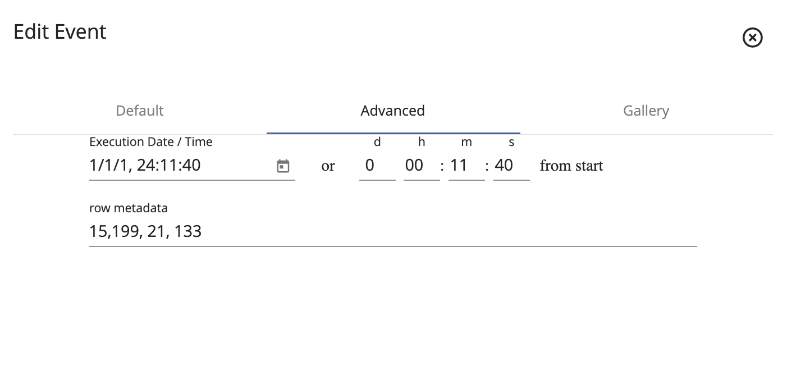

##### Data Format Table

| Field                  | Data Type | Description                                                         | Example             |
| ---------------------- | --------- | ------------------------------------------------------------------- | ------------------- |
| **Exercise Date/Time** | Datetime  | Start date/time of the move exercise-time                           | 1/24/2024, 14:18:27 |
| **Row Metadata**       | Integer   | Defines the size of this event on the Events and Exercise View tabs | 15,199,21,133       |

If the MSEL owner enabled Gallery integration, the user should verify that all fields on the **Gallery** tab are complete, following the Data Format Table specifications below. This tab includes the fields required for the Gallery integration to function properly.

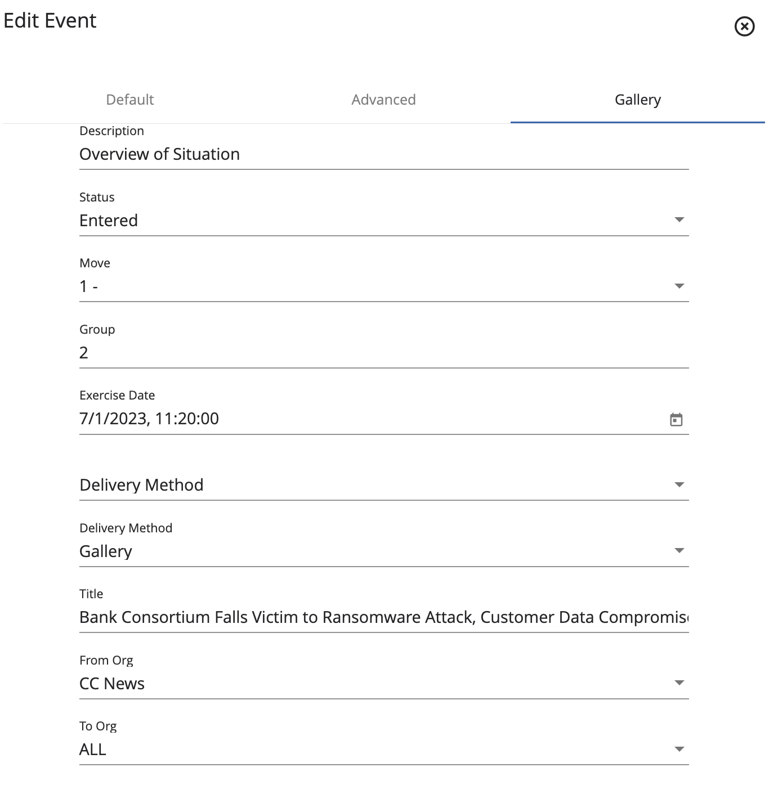

##### Data Format Table

| Field               | Data Type     | Description                                                                  | Example                                           |
| ------------------- | ------------- | ---------------------------------------------------------------------------- | ------------------------------------------------- |
| **Description**     | String        | Information, details, and characteristics of the event                       | STARTEX                                           |
| **Status**          | Dropdown Text | Approval status of the event used on the MSEL                                | Approved                                          |
| **Move**            | Dropdown Text | Move number that the event is part of                                        | 1                                                 |
| **Group**           | Integer       | Groups events within a move, often times executed within the same time range | 1                                                 |
| **Exercise Date**   | Datetime      | Start date/time of the move exercise-time                                    | 1/24/2024, 14:18:27                               |
| **Delivery Method** | Dropdown Text | How is the event delivered to participants                                   | Gallery                                           |
| **Title**           | String        | Title of the event                                                           | Bank Consortium Falls Victim to Ransomware Attack |
| **From Org**        | Dropdown Text | Select the organization that sends this event                                | CC News                                           |
| **To Org**          | Dropdown Text | Select the organization that receives this event                             | All                                               |

After you've added all desired configurations, click **Save**.

##### Add Color to an Event

To add a color to an existing event, follow these steps:

1. Navigate to the **Events** tab.
2. Select the event you want to edit and click the **Hamburger** icon next to it.
3. Hover over **Highlight**.
4. Here, users can select the desired color.

##### Edit an Event

To edit the event's details, follow these steps:

1. Navigate to the **Events** tab.
2. Select the event you want to edit and click the **Hamburger** icon next to it.
3. Click **Edit**. The system opens the same edit component used when creating a new event.
4. Make your changes, then click **Save**.

##### Delete an Event

To delete an event, follow these steps:

1. Navigate to the **Events** tab.
2. Select the event you want to delete and click the **Trash Can** icon next to it.

##### Search for an Event

To search for a specific event, follow these steps:

1. Navigate to the **Events** tab.
2. Click the **Search Bar** and type the name of the desired event.

#### Exercise View

While the **Events** tab lets MSEL owners and content developers manage events, the **Exercise View** tab gives participants read-only access to track current and future events during an exercise.

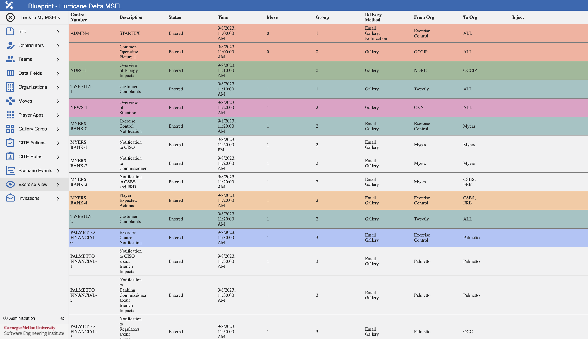

#### Assessor View

The **Assessor View** tab is where Evaluators watch a live exercise and rate the participating teams against the MSEL's competencies. Each scenario event shows the xAPI statements the exercise applications recorded for it, beside a competency assessment where the Evaluator rates each competency and submits the rating as an xAPI competency assertion. The MSEL's content is read-only here; the only values an Evaluator can change are **Checkbox** data fields.

The Assessor View is also available outside the MSEL editor via the **Assessor View URL** on the Config tab (`/assess/?msel={mselId}`).

##### Access

| MSEL Role | Access |
| --- | --- |
| **Owner**, **Evaluator** | View the Assessor View and check or clear **Checkbox** data fields |
| **Editor**, **Approver** | View the Assessor View |

System Admins have full access to every MSEL's Assessor View. Users with no role on the MSEL see **Access Denied**.

##### Choose What Assessors See

The Assessor View shows only the columns the MSEL owner marks for it. If none are marked, it shows **No data fields are marked as assessor-visible.**

To choose the Assessor View columns, follow these steps:

1. Navigate to the **Data Fields** tab.
2. Check the **Assessor View** column for each data field the assessors should see. The **Move**, **Group**, **Execution Time**, and **Integration Target** rows control those columns the same way.

To give assessors competencies to rate, attach a framework and its competencies on the [Competencies](#competencies) tab, then associate them with teams and scenario events. The rating levels come from the framework's default proficiency scale.

##### Review xAPI Evidence

Events are grouped under their move and group. Click a move, group, or event row to expand it. Use **Expand All** (Ctrl+Shift+E) and **Collapse All** (Ctrl+Shift+C) in the header to open or close every row.

An expanded row shows **xAPI Evidence** on the left: the statements recorded for that move, group, or event, with their time, platform, actor, team, verb, and object. Click a statement to see its JSON, or click **Copy JSON** to copy it. Narrow the list with the **Team**, **Source** (Blueprint, CITE, Steamfitter, Player, or Gallery), and **Verb** filters, and click **Refresh xAPI statements** to load new ones.

Click **Search Events** in the header to search the events and filter them by the values of their data fields.

##### Submit a Competency Assessment

The **Competency Assessment** panel on the right of an expanded row lists the competencies associated with that move, group, or event. To rate them, follow these steps:

1. In **Assess Team**, select the team being assessed. Only teams associated with at least one of the listed competencies appear. When the evidence is filtered to a single team, that team is preselected.
2. For each competency, select a **Rating** and optionally enter a **Comment**. Hover over the competency ID to see its name.
3. Click **Submit assertion** to submit one rating, or **Submit All** to submit every rated competency.

Each submitted rating is marked **Submitted**. Blueprint records it in the Learning Record Store (LRS) as an xAPI statement with the `asserted` verb, so xAPI must be configured for Blueprint.

#### MSEL Playbook

The **MSEL Playbook** tab presents scenario events in a printable, page-at-a-time layout intended for offline reference by exercise controllers.

Each event page shows: **Execution Time** (absolute + offset), **Move**, **Group**, **Integration Target**, **Control Number**, **Simulated Time**, **Status**, **Summary**, **From Org**, **To Org**, **Card Id**, **Source Type**, **Source Name**, **Delivery Method**, and the **Description** with rendered rich-text content.

Pagination controls (**Previous page**, **Next page**, **Items per page**) appear at the top; the default is one event per page. Visual indicators mark the transition between moves.

Click **Print MSEL Playbook** to open the browser's print dialog with only the playbook content in the printable area.

#### Invitations

Users with Administrator, Content Developer, or designated MSEL contributor roles can create invitations from the Invitations tab. These invitations allow others to join or start the MSEL event.

You can specify email domains and a maximum number of users on the invitations. Invitations link to specific teams added to the MSEL. When users join the event using an invitation, the system assigns them to the corresponding team for the duration of the event.

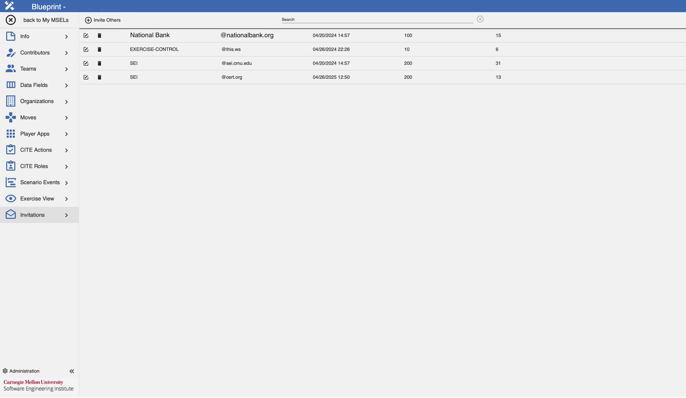

##### Add an Invitation

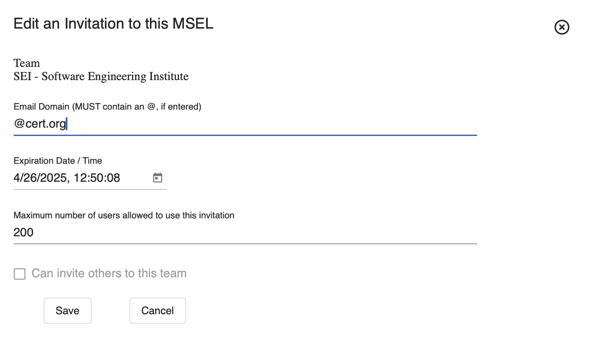

To add a new invitation, follow these steps:

1. Navigate to the **Invitations** tab.
2. Click **Invite Others**.
3. Fill the fields as necessary following the Data Format Table specifications.

##### Data Format Table

| Field                                                      | Data Type     | Description                                     | Example                              |
| ---------------------------------------------------------- | ------------- | ----------------------------------------------- | ------------------------------------ |
| **Team**                                                   | Dropdown Text | Team tied to the invitation                     | SEI - Software Engineering Institute |
| **Email Domain**                                           | String        | User's email domain                             | `@sei.cmu.edu`                       |
| **Expiration Date/Time**                                   | Datetime      | Date and time when the invitation should expire | 04/15/2024 15:12:03                  |
| **Maximum Number of Users Allowed to Use this Invitation** | Integer       | Number of users that can use the invitation     | 5                                    |
| **Can Invite others to this Team**                         | Boolean       | Permission to add others to the team            | False                                |

After you've added all desired configurations, click **Save**.

##### Edit an Invitation

To edit an invitation, follow these steps:

1. Navigate to the **Invitations** tab.
2. Select the invitation you want to edit and click **Edit**. The system opens the same edit component used when creating a new invitation.
3. Make your changes, then click **Save**.

##### Delete an Invitation

To delete an invitation, follow these steps:

1. Navigate to the **Invitations** tab.
2. Select the invitation you want to delete and click the **Trash Can** next to it.

##### Search for an Invitation

To search for a specific invitation, follow these steps:

1. Navigate to the **Invitations** tab.
2. Click the **Search Bar** and type the name of the team tied to the invitation.

### Integrations

Integrations with the following applications simplify configuration steps. This functionality eliminates the need to repeat the same steps in multiple applications.

#### CITE

If enabled, Blueprint can push MSEL information to the CITE application. When the MSEL owner enables CITE integration, additional tabs appear in the Blueprint side panel. The MSEL owner must configure the additional tabs to complete the integration. To enable full CITE integration, the MSEL owner must configure the following tabs:

##### Teams

Use the **Teams** tab to configure CITE settings for teams added to the MSEL. To do this, follow these steps.

First, assign a CITE Team Type to each team.

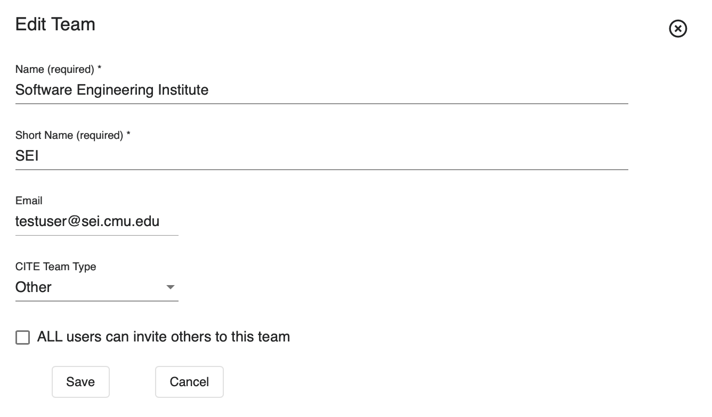

1. Navigate to the **Teams** tab.
2. Select the desired team and click **Edit**.
3. Fill the fields as necessary following the Data Format Table specifications.

##### Data Format Table

| Field              | Data Type     | Description                               | Example                 |
| ------------------ | ------------- | ----------------------------------------- | ----------------------- |
| **Team Email**     | String        | Team's email contact                      | `seicmu@cmu.edu`        |
| **CITE Team Type** | Dropdown Text | Classifies the team within a certain type | Individual Organization |

After you've made all desired configurations, click **Save**.

Next, assign roles to each member of the team. To do this, follow these steps:

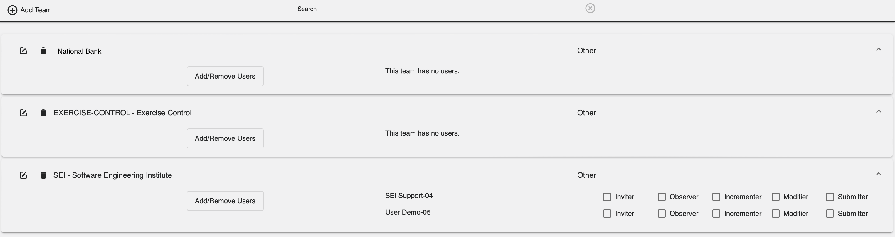

1. Navigate to the **Teams** tab.
2. Select the desired team, and click it to expand its configurations.
3. In each member's **Type** column, select their CITE team role.

##### CITE Team Roles

The **Type** list shows the team roles defined in CITE. Blueprint gives each member that role in CITE when it pushes the MSEL. CITE comes with these roles:

| Role | Can do in CITE |
| --- | --- |
| **Owner** | View the team, answer, submit the team's score, and manage the team |
| **Submitter** | View the team, answer, and submit the team's score |
| **Contributor** | View the team and answer |
| **Member** | View the team |

A CITE administrator can add roles, such as one that can see or change the official score. Blueprint lists them once they exist.

!!! warning

    A member whose **Type** is **-- None --** gets no role in CITE. CITE then disables their answer boxes, so they cannot score. Give every participant a role before pushing: for example, **Submitter** for the team's recorder and **Contributor** for the others.

    People who join a team through an [invitation](#invitations) after the push are added to the CITE team with no role. Give them a role in CITE before play.

##### CITE Actions

On this tab, the MSEL owner can add [CITE Actions](#glossary) to push from Blueprint. These actions allow team members to customize their response by tracking tasks during the exercise.

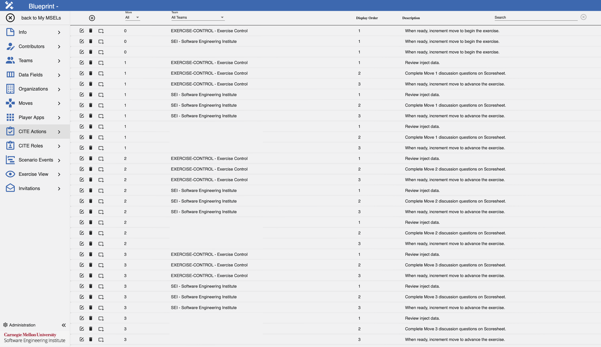

##### Add a CITE Action

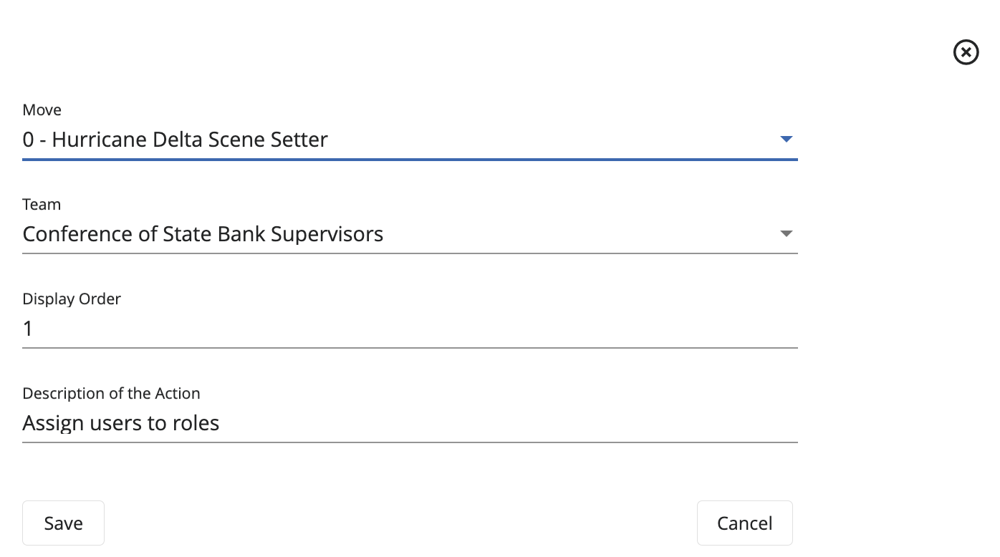

To add a CITE Action, follow these steps:

1. Navigate to the **CITE Actions** tab.
2. Click the **+** icon.
3. Fill the fields as necessary following the Data Format Table specifications.

##### Data Format Table

| Field                         | Data Type     | Description                                                      | Example                              |
| ----------------------------- | ------------- | ---------------------------------------------------------------- | ------------------------------------ |
| **Move**                      | Dropdown Text | Select the move to display this action                           | 0 - Hurricane Delta Scene Setter     |
| **Team**                      | Dropdown Text | Select the team this action applies to                           | Conference of State Bank Supervisors |
| **Display Order**             | Integer       | Indicates the order to display this action on the CITE Dashboard | 1                                    |
| **Description of the Action** | String        | Information, details, and characteristics of the action          | Assign users to roles                |

After you've added all desired configurations, click **Save**.

##### Edit a CITE Action

To edit the CITE Action's details, follow these steps:

1. Navigate to the **CITE Actions** tab.
2. Select the action you want to edit and click **Edit** next to it. The system opens the same edit component used when creating a new action.
3. Make your changes, then click **Save**.

##### Delete a CITE Action

To delete a CITE Action, follow these steps:

1. Navigate to the **CITE Actions** tab.
2. Select the action you want to delete and click the **Trash Can** next to it.

##### Filter Actions by Team

To filter CITE Actions by teams, follow these steps:

1. Navigate to the **CITE Actions** tab.
2. On the **Team** dropdown, select the desired team to filter by.

##### Search for an Action

To search for a specific action, follow these steps:

1. Navigate to the **CITE Actions** tab.
2. Click the **Search Bar** and type the name of the desired action.

##### CITE Roles

On this tab, the MSEL owner can add [CITE Roles](#glossary) to push from Blueprint. These roles allow team members to customize their response by tracking their responsibilities during an exercise.

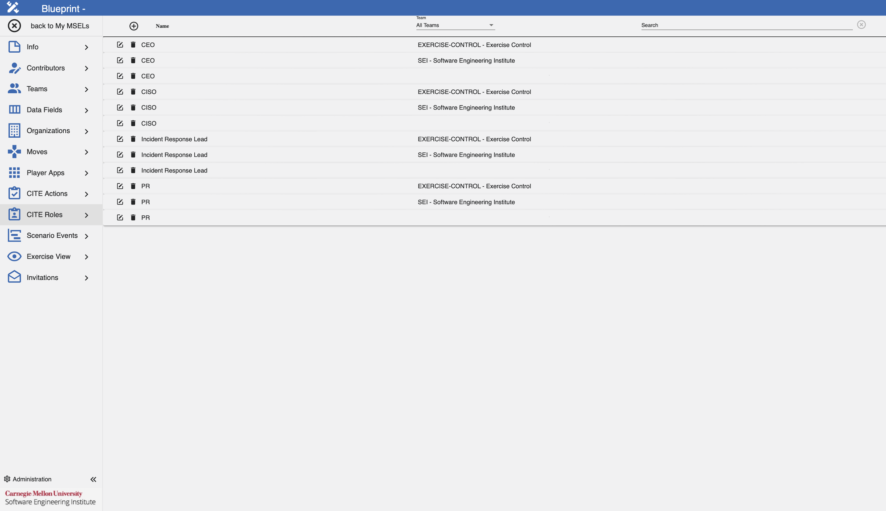

##### Add a CITE Role

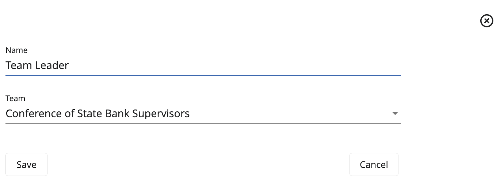

To add a CITE role, follow these steps:

1. Navigate to the **CITE Roles** tab.
2. Click the **+** icon.
3. Fill the fields as necessary following the Data Format Table specifications.

##### Data Format Table

| Field    | Data Type     | Description                          | Example                              |
| -------- | ------------- | ------------------------------------ | ------------------------------------ |
| **Name** | String        | Name of the role                     | Team Leader                          |
| **Team** | Dropdown Text | Select the team this role applies to | Conference of State Bank Supervisors |

After you've added all desired configurations, click **Save**.

##### Edit a CITE Role

To edit the CITE Role's details, follow these steps:

1. Navigate to the **CITE Roles** tab.
2. Select the role you want to edit and click **Edit** next to it. The system opens the same edit component used when creating a new role.
3. Make your changes, then click **Save**.

##### Delete a CITE Role

To delete a CITE Role, follow these steps:

1. Navigate to the **CITE Roles** tab.
2. Select the role you want to delete and click the **Trash Can** next to it.

##### Filter Roles by Team

To filter Roles by team, follow these steps:

1. Navigate to the **CITE Roles** tab.
2. On the **Team** dropdown, select the desired team to filter by.

##### Search for a Role

To search for a specific role, follow these steps:

1. Navigate to the **CITE Roles** tab.
2. Click the **Search Bar** and type the name of the desired role.

#### Gallery

If enabled, Blueprint can push MSEL information to the Gallery application. When the MSEL owner enables Gallery integration, additional tabs appear in the Blueprint side panel. The MSEL owner must configure the additional tabs to complete the integration.

To enable full Gallery integration, the MSEL owner should configure the following tabs.

##### Gallery Data Fields

On the **Data Fields** tab, configure additional data fields to push MSEL information to Gallery.


The MSEL owner should add these fields:

##### Data Format Table

| Field                 | Data Type     | Description                                                               | Example                                       |
| --------------------- | ------------- | ------------------------------------------------------------------------- | --------------------------------------------- |
| **Description**       | String        | Information, details, and characteristics of the event                    | `STARTEX`                                     |
| **Date Posted**       | Datetime      | Posted date of the event                                                  | `1/24/2024, 14:18:27`                         |
| **Delivery Method**   | Dropdown Text | How is the event delivered to participants                                | `Gallery`                                     |
| **Name**              | String        | Name of the event                                                         | `Common Operating Picture 1`                  |
| **From Org**          | Dropdown Text | Select the organization that sends this event                             | `CC News`                                     |
| **To Org**            | Dropdown Text | Select the organization that receives this event                          | `All`                                         |
| **Summary**           | Rich Text     | Complete information and details of the event                             | `A ransomware attack affected Bank XYZ...`    |
| **Card**              | Dropdown Text | Select the Gallery Card to categorize this event                          | `Information Technology Sector`               |
| **Status**            | Dropdown Text | Approval status of the event used on the MSEL                             | `Approved`                                    |
| **Source Type**       | Dropdown Text | Select where the event's details come from                                | `News`                                        |
| **Source Name**       | String        | Add the author of the event                                               | `BBC News`                                    |
| **Move**              | Dropdown Text | Move number that the event is part of                                     | `1`                                           |
| **Group**             | Integer       | Groups events within a move, often executed within the same time range    | `1`                                           |
| **Url**               | String        | Provide a URL if more information is necessary for participants to access | `www.bbcnews.com/ransomware-attack-xyzbank`   |
| **Open in a New Tab** | Boolean       | Use this option to open the URL in a new tab                              | `True`                                        |

After adding data fields, map each one to the appropriate Gallery field by selecting an option from the **Gallery Article Parameter** dropdown when adding or editing the field.

On the Scenario Events tab, a field mapped to the **Status** parameter offers Gallery's article statuses as a dropdown of colors: `Gray`, `Green`, `Yellow`, `Orange`, and `Red`. These are the colors the article's card shows on the Gallery wall. Values from older MSELs that use Gallery's former status names show as the matching color.

##### Gallery Cards

On this tab, the MSEL owner can add [Gallery Cards](#glossary) to push from Blueprint. These are the different cards in the Gallery Wall. You can also find articles related to that card here.

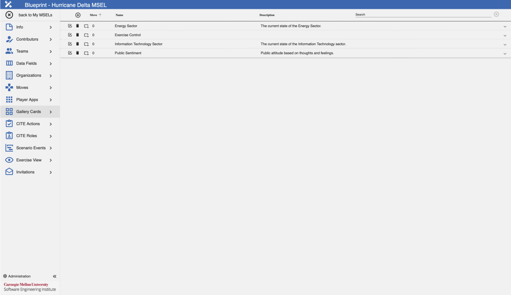

##### Add a Gallery Card

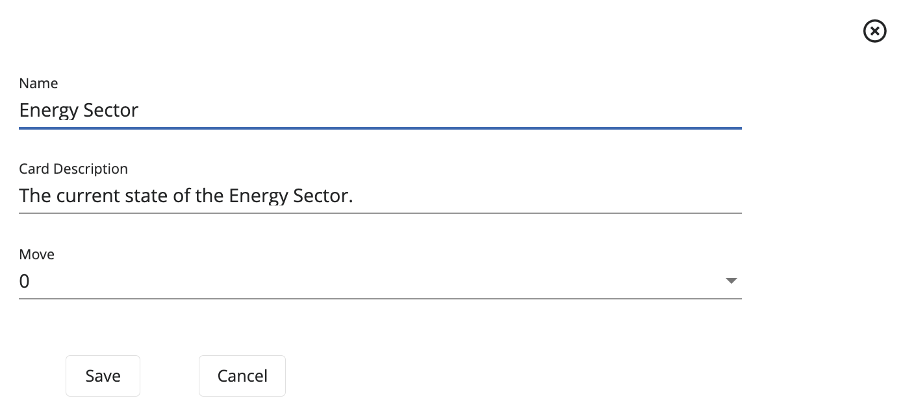

To add a Gallery card, follow these steps:

1. Navigate to the **Gallery Cards** tab.
2. Click the **+** icon.
3. Fill the fields as necessary following the Data Format Table specifications.

##### Data Format Table

| Field                | Data Type     | Description                                                   | Example                                |
| -------------------- | ------------- | ------------------------------------------------------------- | -------------------------------------- |
| **Name**             | String        | Name of the Gallery card                                      | Energy Sector                          |
| **Card Description** | String        | Information, details, and characteristics of the Gallery card | The current state of the Energy Sector |
| **Move**             | Dropdown Text | Select the move to display this Gallery card                  | 0                                      |

After you've added all desired configurations, click **Save**.

##### Edit a Gallery Card

To edit a Gallery card, follow these steps:

1. Navigate to the **Gallery Cards** tab.
2. Select the card you want to edit and click **Edit** next to it. The system opens the same edit component used when creating a new card.
3. Make your changes, then click **Save**.

##### Delete a Gallery Card

To delete a Gallery card, follow these steps:

1. Navigate to the **Gallery Cards** tab.
2. Select the card you want to delete and click the **Trash Can** next to it.

##### Search for a Gallery Card

To search for a specific card, follow these steps:

1. Navigate to the **Gallery Cards** tab.
2. Click the **Search Bar** and type the name of the desired card.

#### Player

If enabled, Blueprint pushes MSEL information to the Player application. The system adds additional tabs to the Blueprint side panel, which the MSEL owner will need to configure.

To enable the full Player integration, configure the following tabs.

##### Player Apps

On the [Player Apps](#glossary) tab, the MSEL owner can add configurations to push from Blueprint. These are the different applications accessible from the [Player View](#glossary).

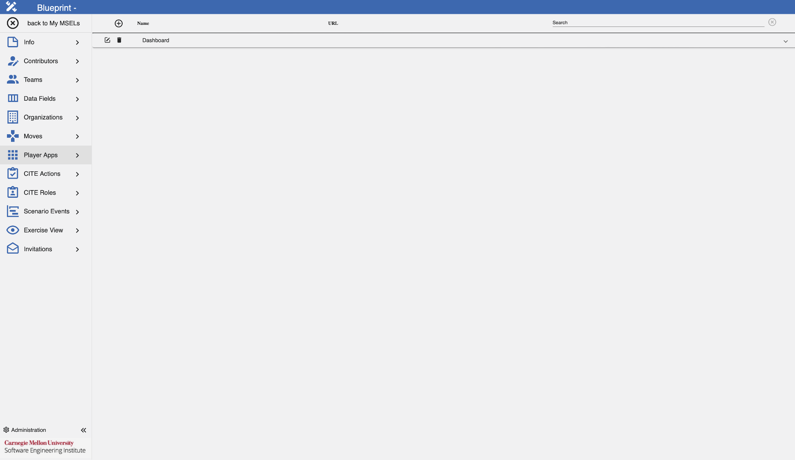

##### Add a Player App

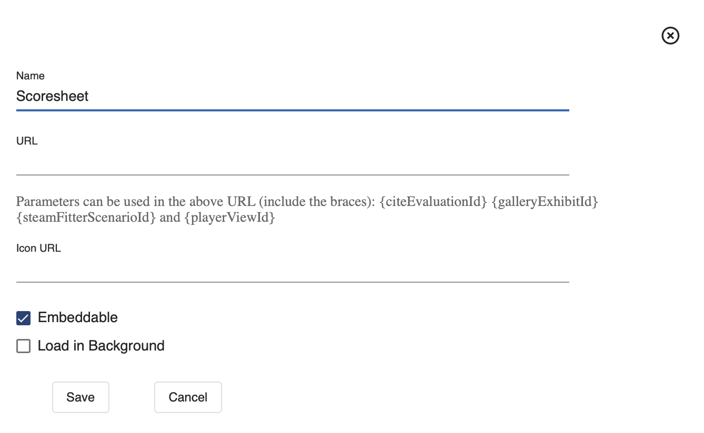

To add a Player app, follow these steps:

1. Navigate to the **Player Apps** tab.
2. Click the **+** icon.
3. Select an app template from the provided list.
4. Fill the fields as necessary following the Data Format Table specifications.

##### Data Format Table

| Field                  | Data Type | Description                                          | Example                                         |
| ---------------------- | --------- | ---------------------------------------------------- | ----------------------------------------------- |
| **Name**               | String    | Name of the application                              | Chat                                            |
| **Url**                | String    | URL of the application                               | `roundcube.hamilton.treasury.gov`               |
| **Icon Url**           | String    | URL of the application's icon                        | `roundcube.hamilton.treasury.gov/roundcube.png` |
| **Embeddable**         | Boolean   | Select whether to embed the app in Player's iFrame   | True                                            |
| **Load in Background** | Boolean   | Select whether the app should load in the background | True                                            |

##### URL Parameters

You can add URL parameters to point to a specific CITE evaluation, Gallery exhibit, Player view, or other content. To do this, include the variables in braces when adding a new application. Consider using the following variables:

- **{citeEvaluationId}:** Add this variable to the URL to point to a specific CITE evaluation.
- **{galleryExhibitId}:** Add this variable to the URL to point to a specific Gallery exhibit.
- **{steamFitterScenarioId}:** Add this variable to the URL to point to a specific Steamfitter scenario.
- **{playerViewId}:** Add this variable to the URL to point to a specific Player view.
- **{casterWorkspaceId}:** Add this variable to the URL to point to the Caster workspace the MSEL deployed.
- **{vmUrl}:** Add this variable to the URL to point to the VM UI, for example `{vmUrl}/views/{playerViewId}`.

After you've added all desired configurations, click **Save**.

##### Edit a Player App

To edit a Player app, follow these steps:

1. Navigate to the **Player Apps** tab.
2. Select the app you want to edit and click **Edit** next to it. The system opens the same edit component used when creating a new app.
3. Make your changes, then click **Save**.

##### Delete a Player App

To delete a Player app, follow these steps:

1. Navigate to the **Player Apps** tab.
2. Select the app you want to delete and click the **Trash Can** next to it.

##### Search for a Player App

To search for a specific app, follow these steps:

1. Navigate to the **Player Apps** tab.
2. Click the **Search Bar** and type the name of the desired app.

#### Caster

If enabled, Blueprint deploys the MSEL's virtual machine topology through [Caster](../caster/index.md). On push, Blueprint creates a workspace named `blueprint-{mselId}` in the chosen Caster directory, writes the Player view and team IDs into the workspace as Terraform variables, and plans and applies it. The VMs land in the MSEL's Player view, so the Caster integration requires the Player integration.

##### Choose the Caster Directory

The directory holds the Terraform template to deploy. To choose it, follow these steps:

1. Navigate to the **Info** tab.
2. Under **Applications to Integrate**, check **Player** and **Caster**.
3. In **Directory**, select the Caster directory, listed as *project / directory*.
4. Click **Save Changes**.

The directory list comes from Caster, so the user choosing it needs access to Caster. Without it, Blueprint shows **Caster directories could not be loaded. You need access to Caster to choose one.**

After a push, the **Workspace** row shows the workspace Blueprint created. Click **Open in Caster** to open the Caster project that holds it.

##### Map Teams to the Template

Blueprint writes each Player team's ID to a Terraform variable named after the team: lower case, with spaces turned into underscores. A template that names its team variables differently can still be used by mapping each MSEL team to one of the template's variables.

To map a team, follow these steps:

1. Navigate to the **Teams** tab. The **Topology Team** column shows each team's variable.
2. Click **Edit** next to the team, then select the template variable in **Topology Team**. Select **By team name** to go back to the variable the team's name gives.

Blueprint lists the string variables the template declares, except sensitive ones, ones the template already assigns, and the ones Blueprint writes itself: `view_id`, `user_id`, `username`, and the deprecated `exercise_id`.

The Teams tab warns when a team is mapped to a variable the template no longer declares, and when a template variable has no MSEL team. A variable with no MSEL team and no default in the template fails the Caster plan. If two teams end up with the same variable, the push fails and names the teams.

##### Give Participants the VMs

Participants reach the deployed VMs through the VM UI. Add a [Player app](#add-a-player-app) whose URL uses `{vmUrl}`, for example `{vmUrl}/views/{playerViewId}`. Until the MSEL has one, the **Info** and **Player Apps** tabs warn that participants will not be able to reach the Caster VMs.

#### Push Integrations

After adding all of the MSEL information and performing all necessary configurations, you can push information from enabled integrations to their respective applications.

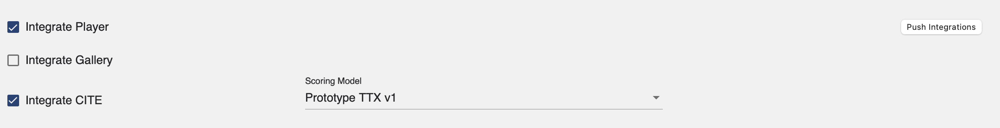

To push MSEL information to their respective applications, follow these steps:

1. Navigate to the **Info** tab.
2. Click **Push Integrations**.

When Caster is enabled, Blueprint deploys the topology last, after the other integrations, because the Terraform apply can take a long time.

#### Remove Integrations

If desired, the MSEL owner can remove MSEL information after the enabled integrations have pushed it to their respective applications.

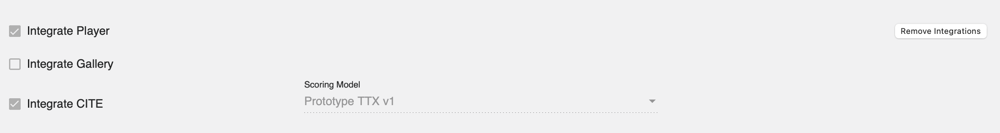

To remove MSEL information from the applications, follow these steps:

1. Navigate to the **Info** tab.
2. Click **Remove Integrations**.

When Caster is enabled, Blueprint destroys the Caster workspace first, while the Player view its VMs belong to still exists. If the destroy fails, Blueprint stops and keeps the other integrations, so **Remove Integrations** can be run again.

## Glossary

This glossary defines key terms and concepts used in the Blueprint application.

**`Approver` Role:** Can view and edit the MSEL, but will have the added feature of approving a MSEL.

**Assessor View:** MSEL view used by Evaluators during an exercise to review xAPI evidence and submit competency ratings for teams. Directly accessible via the Assessor View URL on the Config tab.

**Blueprint**: Web application created to make the development of a MSEL and events easier.

**Caster:** Web application that deploys virtual machine topologies from Terraform templates organized in projects, directories, and workspaces.

**Catalog:** A reusable, named collection of scenario events associated with a specific inject type. Catalogs are defined in Administration → Catalogs and can be pulled into MSELs.

**CITE:** Web application that allows multiple participants from different organizations to evaluate, score, and comment on cyber incidents.

**CITE Action:** Series of steps to guide users on an appropriate course of action during an exercise.

**CITE Team Role:** What a team member can do in CITE: Owner, Submitter, Contributor, Member, or a role a CITE administrator adds. Set in each member's **Type** on the Teams tab and given to them in CITE when the MSEL is pushed. See [CITE Team Roles](#cite-team-roles).

**`CITE` Role:** Provide a set of responsibilities assigned to a user during an exercise.

**Competency:** A work role, task, knowledge, skill, or ability that comes from a competency framework and can be attached to a MSEL, a team, or a scenario event.

**Competency Framework:** A named collection of competencies (for example, NICE Framework) defined in Administration → Competencies and linked to a proficiency scale.

**Content Developer Permission:** Can view, edit, create, and approve events on the MSEL.

**Data Fields:** Structured components containing essential information about the event's characteristics, context, and implications.

**`Editor` Role:** Can edit the events assigned to them by the MSEL owner, but not other events. They cannot delete events or create new events.

**Event Dashboard:** Blueprint's homepage. Presents up to three cards (Join an Event, Start an Event, Manage an Event) tailored to the user's permissions.

**Events**: Specific scenario events or messages within the scenario that prompt users to implement designated actions.

**Exercises**: Structured and simulated activity designed to assess, train, or evaluate the capabilities, preparedness, and responses of individuals, teams, or organizations in dealing with various scenarios, especially emergencies or crises.

**Evaluator Permission**: Manages the exercise, can advance moves, execute events, and check events as completed.

**Gallery:** Web application where participants receive incident information.

**Gallery Card:** The Gallery wall displays Gallery cards. Each Gallery card represents an article category. Cards show a background color based on the most recent article's status and the number of unread articles. Content developers define cards within each Gallery collection.

**Group:** A named collection of users defined in Administration → Groups. Used for bulk permission management.

**Inject Type:** A named template describing the structure and data fields for a category of scenario events. Defined in Administration → Inject Types.

**Move Editor:** Can edit moves on the MSEL, as well as increment them during an exercise.

**Moves:** A defined period of time during an exercise, where exercise organizers distribute a series of events for users to discuss and assess current incident severity.

**MSEL:** (Master Scenario Events List) provides a timeline for all expected events, affiliated users and organizations during an exercise.

**MSEL Playbook:** A printable, paginated view of a MSEL's scenario events intended for use by exercise controllers.

**Organizations:** Entities within an exercise with defined roles, responsibilities, and functions.

**`Owner` Role:** Owner of the MSEL, can view and edit as well as perform all functionality that the MSEL provides (e.g., Add Teams, Add Integrations, Events).

**Player:** Centralized web interface where participants, teams, and administrators go to engage in a cyber event.

**Player Apps:** List of applications accessible from the same Player view.

**Player View:** These are the settings associated with building a view. You can edit, clone, and delete a view.

**Proficiency Scale:** A reusable, named set of performance levels (for example, Novice, Intermediate, Advanced, Expert) attached to a competency framework.

**Steamfitter:** Gives content developers the ability to create scenarios consisting of a series of scheduled tasks, manual tasks, and events which run against virtual machines during an event.

**System Admin Permission:** Can add users to a team, as well as assign the required permissions.

**System Defined Data Fields:** Added by default in MSEL creation, since data fields under this category are essential for MSEL features to work.

**User Defined Data Fields:** The user adds on an as-needed basis.

**`Viewer` Role:** Can view the MSEL, but can't do any edits to it.
