# {: style="height:75px;width:75px"} TopoMojo: Building Virtual Labs

This documentation introduces users to the TopoMojo environment and provides information necessary to launch existing labs and create new topologies.

## Overview

TopoMojo is a web application used for creating and delivering cybersecurity training labs and exercises. With TopoMojo, users can build and deploy labs in an isolated and secure virtual machine environment.

TopoMojo allows for the same functionality and connectivity that users would experience with real, physical devices. Network topologies can utilize not only IP and Ethernet, but also custom protocol solutions like 802.11 wireless packet simulation.

New topologies can be rapidly deployed using existing templates or built from the ground up with user-provided ISO's and VM specifications.

TopoMojo uses a hypervisor in the back-end to deploy virtual machines and configure virtual networks. Supported hypervisors are VMware vSphere and Proxmox.

Go to the TopoMojo repository: [github.com/cmu-sei/TopoMojo](https://github.com/cmu-sei/TopoMojo).

## TopoMojo Concepts

Understanding the key concepts in TopoMojo helps you build and manage labs and challenges effectively.

### Workspace and Gamespace

In a *workspace*, engineers add VMs, save updates, author guides, and configure questions/answers to turn the topology into a lab or challenge.

Users play through a lab in a *gamespace*. Users get their own, isolated, read-only copies of all resources in the workspace. Players in a gamespace can interact with VMs and answer questions to complete the lab, but they cannot save changes to the environment.

### Isolation Tag

The "Isolation Tag" is a unique identifier TopoMojo uses to identify a workspace or gamespace. This ID uniquely identifies each workspace and gamespace in the TopoMojo database.

- For a workspace: the *isolation tag* is the workspace id visible above the Workspace Title when viewing the workspace.

   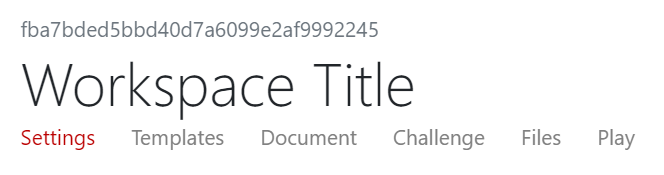

- For a gamespace: the *isolation tag* is the gamespace id partially visible from the **Admin**, **Gamespaces** view and fully visible in the URL bar when viewing a VM console that belongs to a gamespace.

   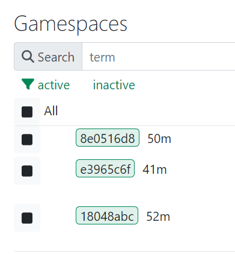
   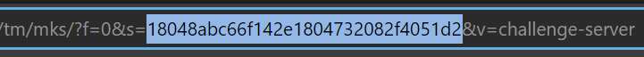

Each resource (e.g., virtual machine, virtual network, etc.) associated with a workspace or gamespace will have the isolation tag appended to the resource name. For example: a VM named `challenge-sever` in the gamespace with id (isolation tag) `18048abc66f142e1804732082f4051d2`, has the name `challenge-server#18048abc66f142e1804732082f4051d2`. Appending the isolation tag to workspace/gamespace resources ensures environment isolation and unique resource naming.

### Labs and Challenges

A *lab* or *challenge* is a TopoMojo workspace built to teach or test hands-on cybersecurity skills. *Labs* are typically designed to be instructional with detailed documents that might resemble a full walkthrough. *Challenges* are typically skills assessments with minimal instructions designed to test a user's skills or for use in a competition (e.g., Capture the Flag competition).

Third-party consumers of TopoMojo content, like [Gameboard](../gameboard/index.md) and [Moodle](../integrations/index.md#moodle), can deploy labs and challenges.

## Getting Started

The following sections cover how to install TopoMojo and configure it for your environment.

### Installing

Install TopoMojo using the [Helm chart](https://github.com/cmu-sei/helm-charts/tree/main/charts/topomojo). The TopoMojo chart contains two sub-charts: `topomojo-api` and `topomojo-ui` which you configure and deploy using the main `topomojo` chart.

!!! info

    This `api`/`ui` structure is consistent with the other Crucible apps.

**`TopoMojo values.yaml`:** Contains default configurations for the `api` and the `ui`. To deploy TopoMojo, configure the **`Values.yaml`** file according to your needs then `helm install`. More details on how to configure the values file is [available in the helm charts repository](https://github.com/cmu-sei/helm-charts/tree/main/charts/topomojo).

For hypervisor settings, see the TopoMojo repository: [Using Proxmox with TopoMojo](https://github.com/cmu-sei/TopoMojo/blob/main/docs/Proxmox.md) covers network setup, ISO storage, guest settings, and High Availability (`Pod__EnableHA` and related settings), and [Using vSphere with TopoMojo](https://github.com/cmu-sei/TopoMojo/blob/main/docs/vSphere.md) covers vSphere.

!!! warning "Proxmox certificate validation"

    Recent TopoMojo releases honor `Pod__IgnoreCertificateErrors` for Proxmox; earlier releases ignored it there and accepted any certificate. The setting defaults to `false`, so a Proxmox server with a self-signed or otherwise untrusted certificate now fails to connect. Install a certificate the TopoMojo host trusts, or set `Pod__IgnoreCertificateErrors = true`.

### Persistent/Shared Networks

We recommend having a persistent/shared network available to all TopoMojo workspaces/gamespaces. The administrator defines a persistent/shared network at the time they deploy the TopoMojo API.

For example, you could create a persistent/shared network that provides internet access to TopoMojo VMs connected to the network named `bridge-net`.

Use the `Pod**Vlan**Reservations` environment variable to define the name of a persistent/shared network.

- `Pod**Vlan**Reservations**0**Id:` defines the vlan Id (from the hypervisor) that corresponds to the shared/persistent network.
- `Pod**Vlan**Reservations**0**Name:` defines the name of the persistent/shared network.

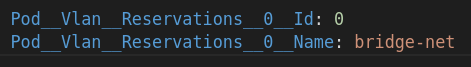

You can define more than one shared/persistent network by incrementing the variable name (`Pod**Vlan**Reservations**1**Id` and `Pod**Vlan**Reservations**1**Name`). To connect VMs to shared/persistent networks, users must have at least **Builder** permissions.

Two settings relax those network restrictions:

- **`Core__AllowUnprivilegedVmReconfigure`** (default `false`): Lets users below **Builder** move a VM's network adapter onto shared/persistent networks.
- **`Core__AllowPrivilegedNetworkIsolationExemption`** (default `false`): On vSphere, lets **Builders** connect a VM to any hypervisor network, not only the workspace's networks and the shared/persistent networks.

!!! note "A note about bridge-net"

    `bridge-net` is just an example based on SEI's network naming convention for this persistent/shared network. It is not always configured as a reserved vlan by TopoMojo.

### Using a VM Console

TopoMojo provides web-based consoles for interacting with virtual machines using only a modern web browser. The control panel on the left of the VM console offers additional options for using the VM console.

- **Settings ( <i class="fa-solid fa-gear" aria-label="settings-icon" role="img"></i> ):** Configure behavior/preferences for the console interface.
  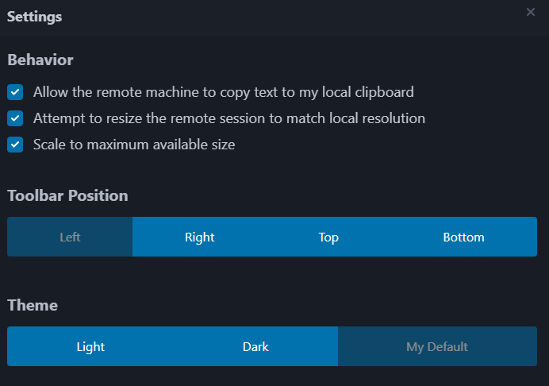
- **Reconnect ( <i class="fa-solid fa-arrow-rotate-right" aria-label="reconnect-icon" role="img"></i> ):** Refresh the connection to the VM.
- **Keyboard ( <i class="fa-regular fa-keyboard" aria-label="keyboard-icon" role="img"></i> ):** Send keystrokes to the VM (e.g., `ctrl + alt + del`).
- **Clipboard ( <i class="fa-regular fa-copy" aria-label="clipboard-icon" role="img"></i> ):** Copy/paste with this VM by selecting text to copy out of the VM to your host or paste text from your host to the VM.
  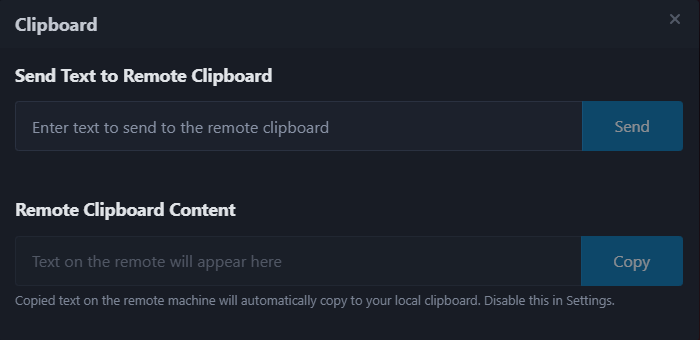
- **Networks ( <i class="fa-solid fa-network-wired" aria-label="networks-icon" role="img"></i> ):** Change the networks a VM's network interface card is on.
- **Screenshot ( <i class="fa-solid fa-camera" aria-label="screenshot-icon" role="img"></i> ):** Take a screenshot of the VM. The screenshot is automatically copied to your host clipboard.
- **Record (<span class="fa-stack" aria-label="record-icon" role="img" style="font-size: 0.75em;"><i class="fa-solid fa-expand fa-stack-2x"></i><i class="fa-solid fa-circle fa-stack-1x"></i></span>):** Record the VMs screen and save the recording to your computer.
- **Fullscreen ( <i class="fa-solid fa-expand" aria-label="fullscreen-icon" role="img"></i> ):** Maximize the console's screen.

The console also shows the VM's state. When the VM is powered off, suspended, or unavailable, the console says so instead of showing a blank screen, and it shows progress while the VM starts or migrates. For a stopped VM, click **Power On** to start it from the console; the console connects once the VM is ready. If the connection drops, the console retries automatically.

## Finding a Space

You can browse for existing TopoMojo workspaces and gamespaces using the **Search** field in left panel. Open the left panel from the menu button or by clicking **Find A Space** on the homepage. Click the pin to keep it open beside the page; unpinned, it closes when you click outside it. Enter search terms then click **workspace** or **gamespace** to filter results. The **workspace** section shows workspaces where you are an editor. The **gamespace** section shows spaces that you have permission to deploy as a gamespace (more information on permissions)

Select a gamespace, then click **Start** to "play" the lab -- start by reading the instructions and launching a gamespace resource. You can invite others to play in your gamespace. Click **Invite** to copy an invitation link for sharing. When you're finished, click **End** to destroy your gamespace. The timer counts down how much time remains before the gamespace expires.

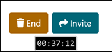

Users can **Favorite** a workspace or gamespace using the **Star ( <i class="fa-solid fa-star" aria-label="fullscreen-icon" role="img"></i> )** button next to the title. Favorites appear at the top of the list.

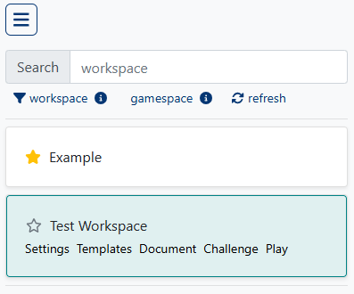

While playing, the **Gamespace Resources** list shows the gamespace's VMs. Use **Deploy** to create them and **Destroy** to delete them.

The **About** page lists the UI and API versions and these keyboard shortcuts:

| Key | Action |
| --- | --- |
| `Ctrl-O` | Open workspace |
| `Ctrl-L` | Toggle left panel |
| `Ctrl-H` | Navigate home |
| `Ctrl-1` to `Ctrl-6` | Open the workspace **Settings**, **Templates**, **Document**, **Challenge**, **Files**, and **Play** tabs |

## Building a New Workspace

To build a new TopoMojo workspace click **New Workspace** from the homepage. The workspace interface contains six tabs: Settings, Templates, Document, Challenge, Files, and Play.

### Settings

The Settings tab holds configuration metadata for your lab.

**Title:** The title of your workspace. While not enforced, the title should be unique to prevent confusion when searching for spaces.

**Description:** A brief description of your workspace to display when browsing titles.

**Tags:** Space-delimited metadata added to help with searching and cataloging spaces. For example, if working several challenges for the "cyber-cup" project, you may tag a workspace with `cyber-cup c01` where `cyber-cup` is the name of the project and `c01` is a challenge number/ID.

**Authorship:** The names of the challenge authors.

**Audience:** A space-delimited list of administrator-defined groups that have permission to deploy gamespaces from the workspace. Administrators define an *audience* with any name here. Users can deploy gamespaces from the workspace only if their *scope* matches one of the provided *audiences*. `everyone` is the global audience that allows all users to deploy gamespaces from the workspace. Audience matching isn't case-sensitive.

`everyone` works because TopoMojo adds `Core__DefaultUserScope` to every user's scope, and that setting defaults to `everyone`. The sample `appsettings.conf` in the TopoMojo repository sets it to `mojo`. If you copy that value, use `mojo` instead of `everyone` as the global audience.

**Duration:** Recommended length of time, in minutes, that it takes to play through the challenge/lab.

**Collaboration:** To share your workspace with others, click **Generate invitation** and send the link to collaborators. Generating a new link invalidates the previous one. Click **Remove** next to a collaborator to take away their access. TopoMojo shows Collaborators alongside the author. When a collaborator connects to your workspace, you'll see them `connected` in the top right corner of the workspace.

**Clone:** Create a copy of your workspace. TopoMojo **links** the cloned workspace VMs to the parent workspace's VMs. The clone inherits all other settings from the parent. TopoMojo appends `-CLONE` to the title of the new workspace, but you can change this title.

**Delete:** Delete the workspace.

The top of the **Settings** tab shows the workspace's **Launch Count** and **Last Activity**. It also warns that inactive workspaces ("unpublished and idle" or "published and unused") may be deleted by the janitor. In the current release, the [Janitor](#janitor) only reports such workspaces; it doesn't delete them.

### Templates

The template selector allows you to add virtual machine templates to your workspace. Templates are "starting point" virtual machines that engineers can add to their workspace and customize as needed.

A typical TopoMojo deployment contains several types of templates.

- Base operating system installs with no software or configurations serve as a known-good starting point for customization.
- Purpose-built templates include preconfigured VMs (e.g., a web server configured to serve content).
- Blank discs let engineers install an operating system not yet available as a template.

Administrators can publish individual templates (e.g., a stand-alone base install of Kali Linux). They can also publish a "template set" of multiple VMs serving as a single "stock topology" (e.g., a full enterprise network with routers, firewalls, services, etc.).

TopoMojo templates are either *published* (stock) or *unpublished*. **Published** templates are available to all workspaces and appear in the **Add Templates** search across TopoMojo. **Unpublished** templates are workspace-specific and only available within the workspace where the user created them. Only administrators can publish a template; see [Publishing a Template](#publishing-a-template) in the Administrator Guide.

#### Adding and Editing Templates

To add a template to your workspace:

1. On the Templates tab, click **Add Templates**.
2. Search for and add the templates you need for your topology.
3. Click the **edit** icon to expand the template metadata and make changes. Making changes inside the VM requires [deploying the VM](#refresh-and-deploy).
   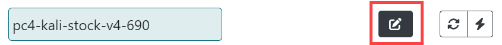

#### Templates Tab Notices

The **Templates** tab shows notices about the workspace's state:

- **Idle VMs:** Any workspace VM left idle for a day may be deleted by the [Janitor](#janitor). Delete template VMs you aren't using.
- **Running gamespaces:** When gamespaces launched from this workspace are still running, TopoMojo can't save changes to its VMs. The **Delete N Gamespaces** button ends them so you can save again. Use it with care; it ends other people's sessions too.
- **Deployed template:** While a template's VM is deployed, the template's fields are read-only. Delete the VM to edit them.

The **Template Manager (admin)** link opens the admin [Templates Tab](#templates-tab) filtered to this workspace; it only works for administrators. When you search **Add Templates**, a published *template set* shows **Add (N)**, where *N* is the number of templates it adds.

#### Template Revisions

When an administrator publishes a new revision of a template, the **Templates** tab offers to move your copy onto it:

- **Change parent to *name*?** appears on a linked template. Click **Resolve** to relink it to the new revision. Your template then uses the new revision's disk.
- **Manually updated to match *name*?** appears on an unlinked template that came from the same parent. Click **Resolve** to record the new revision as its parent. This doesn't change the template's own disk.

TopoMojo only offers revisions that are published or whose **Audience** matches the workspace's template scope.

#### Template Field Definitions

The list below explains the fields in the VM template.

- **Name:** The **name** of the VM must be unique within the workspace and should be descriptive of the resource.
- **Description:** A short description of the VM. Include the credentials and purpose for the VM. The description is not visible to participants; it is only visible in the workspace editor.
- **Networks:** A space-delimited list of networks on which the VM will have a network interface. These names should be the same for all systems in your lab that need to connect to the same network. TopoMojo creates the networks on the hypervisor when it deploys the VM/lab.
- **Guest Settings:** Key-value pairs in the form of `key=value` to pass data into deployed VMs via [VMware guestinfo variables](https://techdocs.broadcom.com/us/en/vmware-cis/vsphere/tools/12-5-0/vmware-tools-administration-12-5-0/configuring-vmware-tools-components/using-vmware-tools-configuration-utility/view-virtual-machine-status-information/query-information-using-guestinfo-variable.html) or the [QEMU Firmware Configuration Device](https://www.qemu.org/docs/master/specs/fw*cfg.html) for Proxmox. The *key* is the name of the guest setting. For example, `var1=test` is a guest setting named "var1" with a value of "test". You can randomize guest settings values using [TopoMojo Transforms](#transforms).

    When using VMware as a backing hypervisor, use [VMware Tools](https://helpmanual.io/help/vmtoolsd/), such as the `vmtoolsd` command from the [open-vm-tools package](https://docs.vmware.com/en/VMware-Tools/12.3.0/com.vmware.vsphere.vmwaretools.doc/GUID-8B6EA5B7-453B-48AA-92E5-DB7F061341D1.html), to access guest info variables from a VM.

    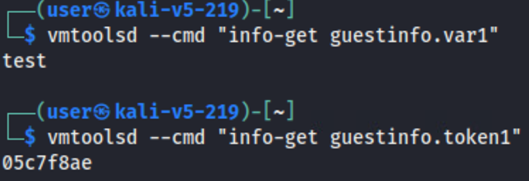

    When using Proxmox as a backing hypervisor, use the [QEMU Firmware Configuration (`fw_cfg`) Device](https://www.qemu.org/docs/master/specs/fw_cfg.html) with a command similar to the following, where `variable` is the key of the guest setting to read:

    ```bash
    sudo cat /sys/firmware/qemu_fw_cfg/by_name/opt/guestinfo.variable/raw
    ```

- **Replicas:** Set this number to deploy copies of the same VM template. For example: to deploy three copies of a VM template when TopoMojo starts a *gamespace*, set **Replicas** to "3". To deploy one copy of the VM template for each member of the team owning the gamespace, set **Replicas** to "-1".
- **Variant:** Specify that TopoMojo should deploy the VM template only for a particular variant. For example, if the Variant is "2", TopoMojo deploys the VM template only when it launches variant 2 of the challenge.
- **ISO:** Use the ISO Selector to attach an ISO image to your virtual machine. Common use: attach an OS installer ISO for a blank disk template, or mount utilities during setup. See [Installing an Operating System from an ISO](#installing-an-operating-system-from-an-iso).

    To detach an ISO, click **Remove** in the **ISO** field. TopoMojo only reads this field when it deploys the VM, and TopoMojo locks the template while its VM exists. Delete the deployed VM first (after saving any changes you want to keep), remove the ISO, then deploy again.

    !!! warning "Proxmox: removing the ISO doesn't clear the CD drive"

        On Proxmox, a template with an empty **ISO** field doesn't get an empty CD drive. The deployed VM keeps whatever CD-ROM the underlying Proxmox template VM has, so clicking **Remove** doesn't detach an ISO that the Proxmox template already carries. To clear it, a Proxmox administrator sets the template VM's **CD/DVD Drive** to **Do not use any media** in Proxmox.

- **Console Access:** Toggle **Hidden** to hide a specific VM from view while completing the lab. This is useful for back-end systems like a DHCP server that do not require user interaction or other systems where the user should not have direct console access.

    !!! note
        These VMs may still be accessible over the network; participants just cannot open a console via the lab interface.

- **Linked:** *Unlinking* creates a new clone of the template which you can save and customize. **Unlink** any virtual machine that will not use the default disk included with the template (i.e., you need to save changes to the VM).
- **Delete Template:** Deletes the template from the workspace.

#### Refresh and Deploy

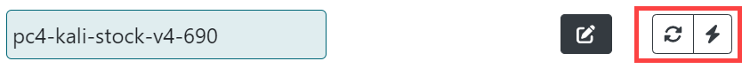

Once the template is in the appropriate state:

- **Initialize ( <i class="fa-solid fa-gear" aria-label="initialize-icon" role="img"></i> ):** Creates the template's disk. Appears only on an unlinked template whose disk doesn't exist yet, such as right after you click **Unlink**. **Deploy** appears once initialization finishes.
- **Refresh ( <i class="fa-solid fa-arrows-rotate" aria-label="refresh-icon" role="img"></i> ):** Refresh queries the state of the VM from the hypervisor. This is useful if you run a `shutdown` command in the VM and the TopoMojo UI icons haven't updated to reflect the powered-off state of the VM yet.
- **Deploy ( <i class="fa-solid fa-bolt" aria-label="deploy-icon" role="img"></i> ):** Deploys that virtual machine into your workspace.

#### Deployed VM Actions

The deployed virtual machine displays the following additional icons from left to right:
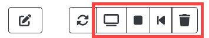

- **Console ( <i class="fa-solid fa-tv" aria-label="console-icon" role="img"></i> ):** Opens the console for the virtual machine.
- **Stop/Start ( <i class="fa-solid fa-stop" aria-label="stop-icon" role="img"></i> / <i class="fa-solid fa-play" aria-label="play-icon" role="img"></i> ):** Power off/on the VM, but leaves the resource deployed on the hypervisor. Clicking **stop** results in the hypervisor showing a deployed VM in a powered-off state. Clicking **start** powers on the deployed VM.
- **Revert ( <i class="fa-solid fa-backward-step" aria-label="revert-icon" role="img"></i> ):** Reverts the VM to its last saved state. You lose all changes made since the last commit. TopoMojo can only revert VMs to their last saved state - there is no history of all previous saved states. **Revert** is only available on vSphere; TopoMojo doesn't support it on Proxmox, so the icon doesn't appear there. On Proxmox, delete the VM and deploy it again to return to the saved state.
- **Delete ( <i class="fa-solid fa-trash" aria-label="delete-icon" role="img"></i> ):** Deletes a running VM instance. Before you click **delete**, make sure you have saved any changes to the disk.
- **Save ( <i class="fa-solid fa-save" aria-label="save-icon" role="img"></i> ):** Save any changes made to the VM. Sometimes called "taking a snapshot", though the technical implementation of this feature may not resemble a true "snapshot" on the hypervisor. The **save** icon is only available when you're using an unlinked disk, since you can't save changes to a linked disk.

    Saving replaces the previous saved state. TopoMojo keeps only one saved state per template, so after a save you can't return to the state before it.

    TopoMojo doesn't require a stopped VM, but saving a running VM is like pulling the power cord mid-write. Shut down from inside the guest operating system before you save, especially after installing software or an operating system.

    TopoMojo refuses to save a workspace VM while any gamespace launched from the workspace is still running.

    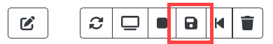

#### Installing an Operating System from an ISO

To build a VM from an operating system installer, combine the steps above in this order:

1. Upload the ISO on the [Files](#files) tab.
2. Add a blank disk template on the **Templates** tab.
3. **Unlink** the template so it gets its own disk.
4. Select the ISO in the template's **ISO** field.
5. **Initialize**, then **Deploy**, and install the operating system from the console.
6. Shut down the VM from inside the guest and click **Save**.
7. Delete the VM, click **Remove** in the **ISO** field, and deploy again to confirm the VM boots from its own disk.

For the full walkthrough, see [Installing an Operating System from an ISO](../tutorials/topomojo-challenge/index.md#installing-an-operating-system-from-an-iso) in the *Creating a TopoMojo Challenge* tutorial.

## Lab Document

The **Document** tab in a TopoMojo workspace is where you write the lab instructions using Markdown syntax in TopoMojo's built-in collaborative editor. Authoring in Markdown enables you to create a formatted document using just plain text.

Because TopoMojo's built-in editor is collaborative, multiple people can work on the documentation at the same time. As long as you are "connected" (see the top-right corner) TopoMojo automatically saves your updates to the document.

For more information about Markdown, including the syntax guide, see [markdownguide.org](https://www.markdownguide.org/).

### Inserting an Image

To insert an image into your document:

1. Click **Images**, then click **Browse** (you can drag and drop too).
2. After browsing to upload an image, you should see a preview of the image.
3. Place your cursor in the document where you want the image, hover over the image, and click **Insert**.

### Previewing the Doc

To see how your instructions will look to players when they "play" your lab, click the **Preview** button. The first screen capture shows the Markdown editor. The second screen capture shows the document in preview mode.

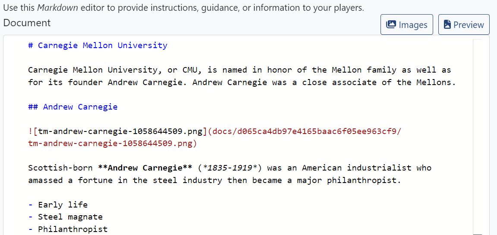

and

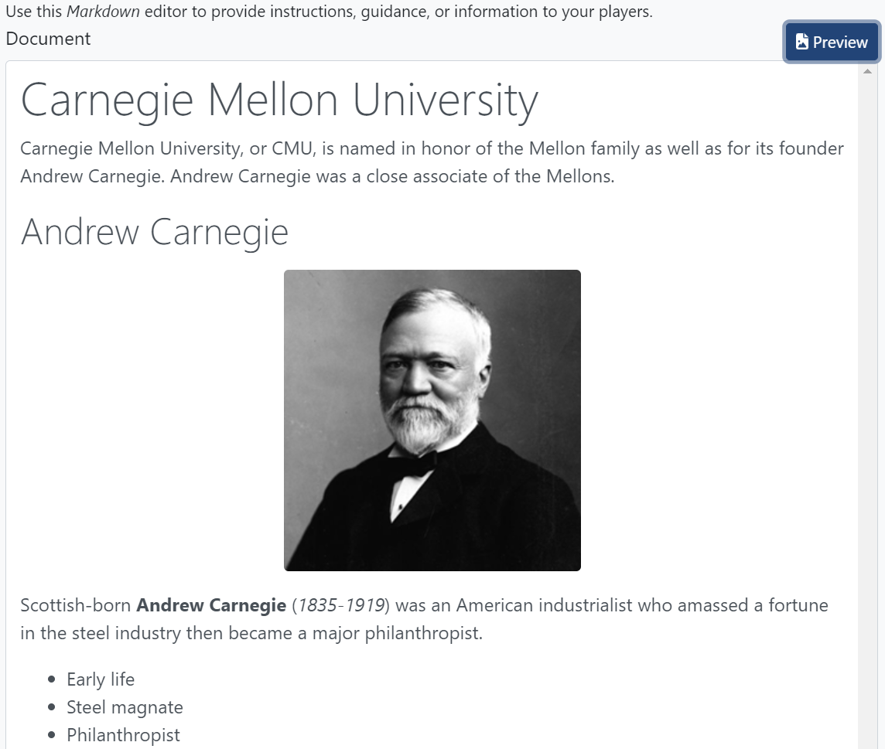

## Challenge Tab

The *Challenge* tab in the TopoMojo workspace is where engineers configure randomized challenge configuration (*transforms*) and questions for the lab/challenge.

Unlike template fields, the Challenge tab doesn't save as you type. Click **Save** when you finish editing.

### Transforms

**Transforms** allow you to define dynamic variables that TopoMojo generates at *gamespace* deploy time. Transforms are key/value pairs –- the **key** is the name of your transform and the **value** is the type of the transform. Expand the tooltip under the transforms text box to see details about the available transform data types. The screenshot below shows a transform named "token1" that will have a value of 8 random hexadecimal characters.

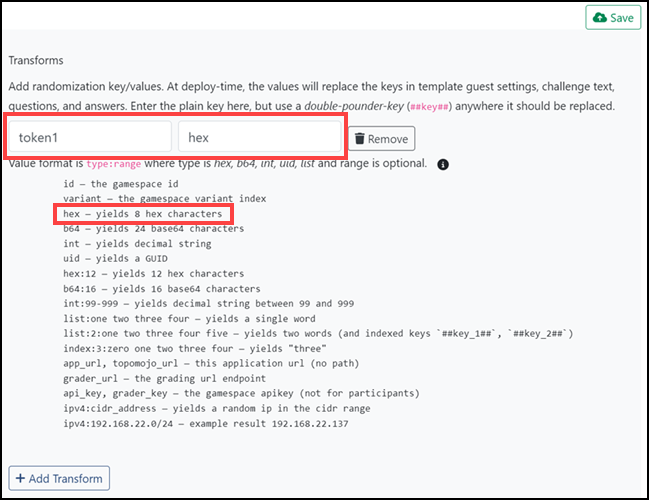

Values use the format `type:range`, where the range is optional:

| Value | Result |
| --- | --- |
| `hex` | 8 random hexadecimal characters. `hex:12` yields 12. |
| `b64` | 24 random base64 characters. `b64:16` yields 16. |
| `int` | A random decimal number. `int:99-999` yields one between 99 and 999. |
| `uid` | A random GUID. |
| `list:one two three four` | One word picked at random from the list. |
| `list:2:one two three four five` | Two words picked at random. Also creates indexed keys, `##key_1##` and `##key_2##`, for each word. |
| `index:3:zero one two three four` | The word at that zero-based position; this example yields `three`. |
| `ipv4:192.168.22.0/24` | A random IP address in the Classless Inter-Domain Routing (CIDR) range, such as `192.168.22.137`. |
| `id` | The gamespace ID. |
| `variant` | The gamespace's variant index. |
| `app_url`, `topomojo_url` | TopoMojo's URL, without a path. |
| `grader_url` | The grading endpoint URL. |
| `api_key`, `grader_key` | The gamespace's API key, for grading scripts inside the lab. Never expose it to participants. |

To access transforms in the challenge, use the referenced "*double-pounder-key* (`##key##`)" notation. When TopoMojo deploys a gamespace, the engine generates random values for all transforms, looks for double-pounder-keys, then replaces them with the randomly generated values for that deployment.

Sections on the Challenge tab (e.g., Transforms, Markdown, Questions, Answers) can contain *double-pounder-keys* that TopoMojo replaces with transform values at deploy time. You can also use transform *double-pounder-keys* in the *Guest Settings* field of a template to inject random variables into VM guest info variables when deploying a gamespace. **Transforms aren't generated when deploying workspace VMs, so the value of the variable will be the *double-pounder-key*.**

The screenshot below shows the Guest Settings of a VM template configured to use two guest info variables: `var1` and `token1`. `Var1` has a value of "test" and `token1` will have a random 8-character hexadecimal string assigned when TopoMojo deploys a gamespace.

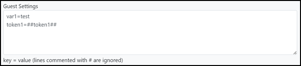

There is a detailed [Guest Settings](#template-field-definitions) portion of the Workspace documentation.

### Markdown

The markdown you enter here gets appended to the gamespace document at deploy time. This section is useful for appending randomized documentation using transforms to the base lab document authored in the **Document** section. For example, if a transform randomizes a system's password, you can document the randomly generated password in this section using the *double-pounder-key* notation for transforms.

### Variants

A *variant* describes a different version of a challenge. Variants can contain different ISO attachments, different virtual machines, and different questions and answers. Each time TopoMojo deploys a challenge, a variant is randomly selected for the deployment. When creating a challenge using variants, make sure all variants test the same competitor skills at the same difficulty level. That is, variant #1 should test the same skills as variant #2 and one variant shouldn't be harder to solve than another variant.

Use the **Clone ( <i class="fa-solid fa-copy"  aria-label="copy-icon" role="img"></i> )** button to create a new variant that is a copy of an existing variant. This makes minor edits between variants easy to facilitate.

Click **Show Variant Detail** to expand each variant's settings:

- **Markdown:** Variant-specific text, appended to the challenge text for players who get this variant.
- **ISO:** A variant-specific ISO **File** and the **Targets** (space-delimited template names) to attach it to. See [Files](#files).

### Question Set

A variant can have more than one *question set*, for grouped tasks or a challenge that unlocks in stages. Each set has a name (shown to players; it defaults to "Question Set N"), optional **Markdown** with instructions for that set, and its own questions. Use the set's controls to move it up or down, clone it, or remove it, and click **Add Question Set** to add another.

To make a set unlock only after players score enough on earlier ones, set its prerequisites:

- **Prerequisite Total Weight:** The weight players must score across all challenge questions.
- **Prerequisite Prev. Section Weight:** The weight players must score in the previous set.

Enter both as fractions of the total score, from `0` to `1`. For example, `0.5` requires half the available points. TopoMojo compares them against normalized question weights, so a value such as `50` never unlocks the set. `0` means no prerequisite. The first set can't have prerequisites. Players see locked sets as a note listing what they must score to unlock the next one.

**Move Up, Move Down, Remove:** Use these functions to position the question in the sequence of questions for that set or remove it.

**Question:** Enter the question you expect the participant to answer here. Your question should be specific, so that there is only one correct answer.

**Answer:** Enter the correct answer that the competitor must submit to earn a score.

You will see these options when you select **Detail ( <i class="fa-solid fa-ellipsis-vertical"  aria-label="detail-icon" role="img"></i> )**.

**Hidden:** Select **Hidden** to prevent the question from appearing when playing the challenge. Hidden questions do not appear when playing in TopoMojo or via Gameboard.

**Grader:** Select the grading type here. The Grader determines if players submitted the correct answer to a question. Select one of four types:

- `Match`: The submission must exactly match what is in the **Answer** field. Use this when there is exactly one possible answer to a question.
- `MatchAny`: The submission must match one of the pipe-delimited answers in the **Answer** field. Use this when there is more than one possible answer to a question.
- `MatchAll`: The submission must match all of the pipe-delimited answers in the **Answer** field. Use this for questions expecting a list of answers.
- `MatchAlpha`: The submission must exactly match what is in the **Answer** field *after* the grader removes all non-alphanumeric characters. This is useful if the user might submit symbols that don't affect the validity of an answer. For example, `C:/Users` and `C:\Users` are both valid answers and the symbols (`/` vs `\`) don't matter.

*All four grader types are case-insensitive - the grader converts all answers and submissions to lowercase before comparing them to the expected answer.*

#### Weight

Weight is the percentage of the total score for this question. The value should be between `0 and 1` or `0 and 100`. The weights of all questions within the set must add up to 100% or one (1). TopoMojo calculates zero (`0`) values evenly.

#### Example

Providing an example answer helps players understand the required answer format. For instance, sometimes a file needs both the name and the extension, while other times only the name is necessary.

## Files

The **Files** tab in the TopoMojo workspace allows you to upload files from your system to TopoMojo to include in your lab. You can use these files as ISOs to attach to VMs in the workspace. If your files aren't already in an ISO file format, TopoMojo wraps them in an ISO after upload. When a template has an ISO selected, the VM will deploy with the ISO attached to the CD Drive. You can attach an ISO to upload software, datasets, or other resources to the VM.

!!! note

    The **Files** tab only appears when the TopoMojo UI settings include `"enable_upload": true`. If you don't see it, ask your administrator to enable it.

    TopoMojo stores uploads in one of two ways. By default, it writes them to `FileUpload__IsoRoot`, which must be a share the hypervisor also mounts, such as an NFS (Network File System) datastore. On Proxmox, that path must end in `/template/iso`. When `FileUpload__UseDatastoreApi` is `true`, TopoMojo uploads to hypervisor storage through the vSphere or Proxmox API instead, and no shared mount is needed.

ISOs you upload on the **Files** tab are *local* to the workspace: only the workspace that holds them can attach them. Administrators manage *global* ISOs, which every workspace can use.

Your TopoMojo administrator controls upload limits:

- **Maximum file size:** `FileUpload__MaxFileBytes`. The default, `0`, means TopoMojo itself sets no limit, but a reverse proxy or ingress in front of TopoMojo may still cap the request size.
- **Upload time-out:** `FileUpload__UploadTimeoutMinutes`, default `60`. This applies when TopoMojo forwards the uploaded file to hypervisor storage through the datastore API (`FileUpload__UseDatastoreApi`).

If a large ISO fails to upload, ask your administrator to check these settings.

By default, the **Local** filter displays only ISOs available to the current workspace. When you upload a local ISO file, TopoMojo creates a folder named by the workspace GUID--highlighted in green below--in the NFS datastore. Only the current workspace has access to local ISO files in the workspace-named folder.

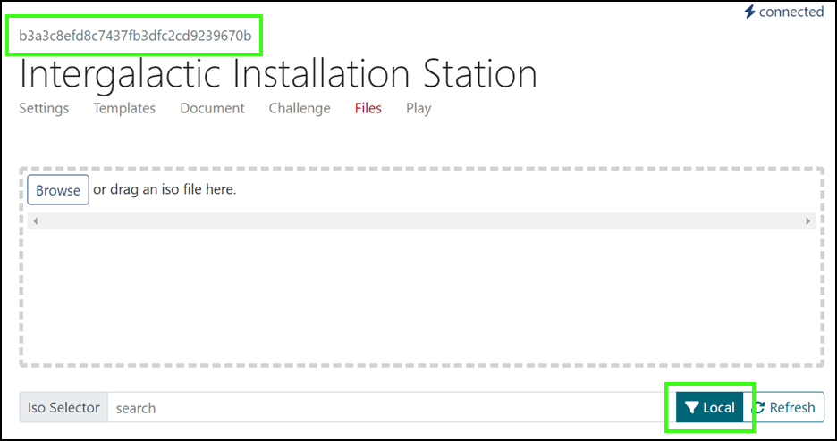

When you remove the **Local** filter, you see ISOs in the global folder on the NFS data store. TopoMojo names the global folder with a GUID of all zeros. These global ISOs are available to every workspace in TopoMojo. Use them for commonly reused ISOs, like operating system installers, to prevent re-uploading the same artifact in multiple workspace folders.

You can attach an ISO to a VM in the challenge workspace **Templates** tab. See the [Adding and editing templates](#adding-and-editing-templates) section of this guide. When you select an ISO here, TopoMojo attaches the ISO to the VM upon its deployment.

You can also attach an ISO to a VM using the workspace **Challenge** tab's **Variant Detail** function. This "dynamic ISO attachment" gives you the ability to attach a variant-specific ISO file to a template. You *must* specify a target(s) here. See the [Variants](#variants) section of this guide.

### Deleting an ISO

To delete a local ISO, click **Delete** next to it in the ISO list and confirm. Any editor of the workspace can delete its local ISOs; only administrators can delete global ISOs, from the [Files Tab](#files-tab) in the Administrator Guide.

Before deleting, TopoMojo checks whether anything uses the ISO. If nothing does, it deletes the file right away. Otherwise, the **Delete ISO** dialog lists the **Templates** and **Active Gamespaces** that use it:

- **Active gamespaces:** You can't delete the ISO until those gamespaces end. Click **Close**.
- **Templates only:** Deleting leaves those templates with a broken ISO reference. Click **Delete Anyway** to continue, or **Cancel**.

## Play

The **Play** tab is where you can interact with your lab in the same way others will when they launch your content or "play" through your challenge. Play deploys a *gamespace*, a read-only copy of all virtual machines in the *workspace*. See more about *gamespaces* in the [Workspace and Gamespace](#workspace-and-gamespace) section.

**Variant:** Specify which variant of the challenge you wish to play (if it is a *variant* challenge). Variant **0** will deploy a random variant.

**Max Attempts:** The maximum number of submission attempts allowed when answering questions.

**Max Minutes:** The maximum number of minutes permitted to play before the gamespace expires.

**Points:** Suggested number of points earned for successfully answering all questions. Consumers (e.g., [Gameboard](../gameboard/index.md) and [Moodle](../integrations/index.md#moodle)) can request any point value when they deploy a gamespace.

**Start:** Starts the gamespace by deploying virtual machines, displaying the Markdown document, making challenge questions available, and starting the timer for the user that clicked **Start**.

**Reset:** Destroys and resets the gamespace.

## Administrator Guide

Access the **Admin Dashboard** by clicking **Admin** in the top right corner of the navigation bar. You need the `admin` role assigned to your user to see the **Admin** navigation option.

The admin area has these tabs: **Dashboard**, **Gamespaces**, **Workspaces**, **Templates**, **Files**, **Disks**, **Machines**, **Users**, **Settings**, and **Log**. The **Dashboard** tab holds the Hub Connections, Announcement, and Janitor tools described next.

### Hub Connections

**Hub connections** informs TopoMojo admins about which users are currently logged into TopoMojo.

### Announcement

The **Announcement** feature allows TopoMojo admins to broadcast important messages to everyone in TopoMojo. Announcements appear in the TopoMojo interface. In the Message field, enter the content of the announcement and click **Send**.

### Janitor

The **Janitor** service cleans up unused resources (e.g., a workspace VM that has been idle for a long time) in TopoMojo. It runs in the background on two schedules:

- About every minute, it ends gamespaces that have passed their expiration time plus their cleanup grace time, then deletes the VMs of ended gamespaces.
- About every one to two hours, it runs a full cleanup pass over workspaces and workspace VMs.

**Cleanup Report:** Runs the full cleanup pass immediately and lists what it found, with sortable **Reason**, **Name**, **Owner**, **VMs**, and **Last Activity** columns. Click a workspace name to open it. This button doesn't just show a log: if the Janitor isn't in dry-run mode, clicking it deletes the VMs it reports.

The full cleanup pass reports three kinds of items, shown in the **Reason** column:

- **IdleWorkspaceVms:** Workspaces whose VMs have been idle longer than `Core__Expirations__IdleWorkspaceVmsExpiration` (default `1d`). When dry run is off, the Janitor deletes these workspace VMs. Saved template disks aren't affected.
- **UnpublishedWorkspace:** Unpublished workspaces idle longer than `Core__Expirations__UnpublishedWorkspaceTimeout` (default `1w`).
- **InactiveWorkspace:** Published workspaces with no launches for longer than `Core__Expirations__InactiveWorkspaceExpiration` (default `1y`).

`Core__Expirations__DryRun` defaults to `true`, which reports idle workspace VMs without deleting them. Set it to `false` to let the Janitor delete them. The Janitor never deletes workspaces themselves: the two workspace reasons are always report-only, regardless of `DryRun`.

!!! warning "Sample configuration key names"

    The sample `appsettings.conf` in the TopoMojo repository lists `Core__Expirations__UnpublishedWorkspacesExpiration` and `Core__Expirations__InactiveWorkspacesExpiration`. TopoMojo ignores those names. Use `Core__Expirations__UnpublishedWorkspaceTimeout` and `Core__Expirations__InactiveWorkspaceExpiration`.

### Gamespaces Tab

The **Gamespaces** tab is where admins search for gamespaces. **Search** matches the gamespace ID, the manager's name, or the workspace title. Use the table headers to sort results by **ID**, **Time Left**, **Created Date**, and **Manager / Workspace**. Use filters to show **active** and **inactive** gamespaces. By default, the search is for *active* gamespaces. Green indicates *active* gamespaces and gray indicates *inactive* gamespaces. An *active* gamespace is one where the player can still interact with VMs and answer questions. An *inactive* gamespace is one the player has completed (answered all questions) or that has expired.

**Refresh:** Refreshes your search.

**Delete Selected:** Check the box next to **All** to select all gamespaces for deletion or check a box next to individual gamespaces to select for deletion.

Gamespaces in the table show the following information:

- **ID:** The first eight characters of the gamespace ID (e.g. `e9416013`).
- **Time Left:** Time remaining, for active gamespaces.
- **Created Date:** When the gamespace was created.
- **Manager / Workspace:** The user who manages the gamespace, and the title of the *workspace* it was launched from.

In the **active** view, click the star next to a gamespace to favorite it and pin it to the top of the list.

When you view a gamespace that has ended but still has VMs on the hypervisor, an **Admin Notice** reports how many VMs remain, with links to the [Machines Tab](#machines-tab) and the **Gamespaces** tab where you can delete them.

The screenshot below shows several active and inactive gamespaces (usernames redacted).

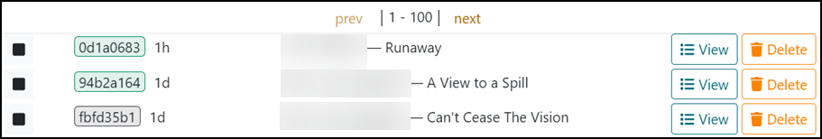

#### View (Expanded)

**View:** Selecting **View** expands the gamespace information where a list of all the VMs associated with the gamespace and their state.

- **Refresh ( <i class="fa-solid fa-arrows-rotate" aria-label="refresh-icon" role="img"></i> ):** Refresh the state of the VM from the hypervisor.
- **Console ( <i class="fa-solid fa-tv" aria-label="console-icon" role="img"></i> ):** Opens the console for the virtual machine, allowing interaction.
- **Stop/Start ( <i class="fa-solid fa-stop" aria-label="stop-icon" role="img"></i> / <i class="fa-solid fa-play" aria-label="play-icon" role="img"></i> ):** Power off/on the VM, but leaves the resource deployed on the hypervisor. Clicking **stop** results in the hypervisor showing a deployed VM in a powered-off state. Clicking **start** powers on the deployed VM.
- **Revert ( <i class="fa-solid fa-backward-step" aria-label="revert-icon" role="img"></i> ):** Reverts the VM to its last saved state. vSphere only; the icon doesn't appear on Proxmox.
- **Delete ( <i class="fa-solid fa-trash" aria-label="delete-icon" role="img"></i> ):** Deletes a running VM instance.
- **JSON ( <i class="fa-solid fa-code" aria-label="code-icon" role="img"></i> ):** Shows detailed information about the gamespace, including: answers to questions, variables associated with the challenge, submitted answers, challenge questions and expected answers, and if the participant answered questions correctly or incorrectly.
- **Dispatcher ( <i class="fa-solid fa-keyboard" aria-label="keyboard-icon" role="img"></i> ) :** Used to issue commands to a VM from TopoMojo provided that the [TopoMojo agent program](https://github.com/cmu-sei/TopoMojo/tree/main/src/TopoMojo.Agent) is running on that VM. The VM requires an internet connection which allows the agent program to establish a connection with TopoMojo. `target` is the hostname of the VM that you want to run the command on. `command` is any command you wish to run. See TopoMojo's [GitHub repository](https://github.com/cmu-sei/TopoMojo/tree/main/src/TopoMojo.Agent) for more information on TopoMojo's agent.

#### Delete

**Delete ( <i class="fa-solid fa-trash" aria-label="delete-icon" role="img"></i> ):** Deletes the gamespace and associated VMs. This deletes the full gamespace record from TopoMojo's database.

### Workspaces Tab

The **Workspaces** tab is where the admin can search for workspaces by name or ID. Use the table headers to sort results by **Workspace Name**, **Created Date**, and **Last Activity**. Click the star next to a workspace to favorite it and pin it to the top of the list.

An admin can view every workspace using this menu, even without being a collaborator. Admins and non-admins use the search feature in the left navigation pane to view workspaces where they are a collaborator. See [Finding a Space](#finding-a-space) for more details.

- **Create:** Create a new workspace from the Admin Workspaces panel. For additional help, see [Building a new workspace](#building-a-new-workspace).
- **UploadZip:** Upload a workspace export (`.zip` or `.json`) to import workspaces into TopoMojo. An **Upload Results** message lists what TopoMojo imported.
- **Download:** Switches the list into selection mode. Check the workspaces to export, then click **Download (N)** to download a zipped export, or click **Cancel**. Workspace exports can contain one or more workspaces. TopoMojo will automatically include additional dependent workspaces and templates for workspaces that contain linked resources.
- **Delete:** Delete a single workspace from its row.

Selecting a workspace takes you the **Settings** tab of that workspace. For additional help on the **Settings** tab, see [Building a new workspace](#building-a-new-workspace).

The *workspace id* is visible above the workspace title, labeled **Workspace ID**. The workspace identifier matches the directory name used to track the workspace in the database, store files on the file system, and track associated VMs. Click the ID to copy it to your clipboard.

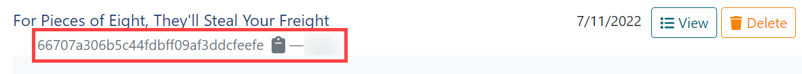

#### View (Expanded)

**Template Limit:** Defines the number of VM templates you can add to the workspace.

**Template Scope:** Limits a workspace to using templates that have the given scope.

**Audience:** Limits who can deploy a gamespace as a workspace.

**VMs:** Refresh, deploy, view the console, start/stop, revert and delete from here. Functions are the same as [previously described](#view-expanded).

### Templates Tab

The **Templates** tab is where you can view all of the templates that exist in TopoMojo.

**Search:** Search for templates by workspace or name. You can apply filters to narrow your search. In the screenshot below, the filter is for linked VMs with a parent template of `kali-201901`.

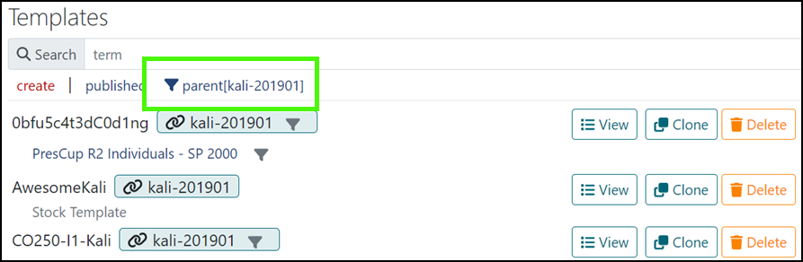

Filter for all templates from a workspace by clicking the *name* of the of the workspace in the list.

!!! note "Linked and unlinked templates"

    The chain link icon ( <i class="fa-solid fa-link" aria-label="link-icon" role="img"></i> ) next to a template name indicates the VM is *linked*. Use linked VMs when the prebuilt, stock templates included with TopoMojo meet your needs. Linked VMs save resources when VMs don't require custom configurations when deployed. Changes can't be saved to linked VMs when deployed. Changes can only be saved to *unlinked* VMs.

    Unlinked VMs are marked with the unlinked icon ( <i class="fa-solid fa-unlink" aria-label="unlink-icon" role="img"></i> ) and show the parent template name.

The **Templates** tab also has these tools:

- **Create:** Create a new template that isn't in any workspace.
- **published:** Filter the list to published templates.
- **parent[...]:** Click the parent name on a template to filter to templates derived from that parent. Click the filter to clear it.
- **Workspace name:** Click a template's workspace to filter to that workspace's templates. Templates outside any workspace show **Stock Template**.
- **Favorite:** Click the star next to a template to pin it to the top of the list.
- **Clone:** Create an unlinked, unpublished copy of a template, with the original as its parent. If the name ends in a version such as `v1`, the copy is named `v2`; otherwise TopoMojo appends `-CLONE`. The copy keeps the original's **Detail**, including its disk paths. Once you publish the copy, workspace templates derived from the same parent see a [Resolve](#template-revisions) prompt.

!!! warning "No isolation checking outside a workspace"

    Templates you edit from this tab aren't inside a workspace, so TopoMojo doesn't apply its usual isolation checks.

#### Template Properties

The **Templates** tab in the Administrator Guide displays template metadata and configuration. The **Detail** field contains the raw JSON configuration TopoMojo passes to the hypervisor when deploying the VM. Linked templates show the read-only **Parent Detail** instead, since they inherit their configuration from the parent.

!!! note
    The Detail field hint text reads: "Advanced configuration. Keep valid JSON to avoid errors."

##### Template Detail JSON

!!! warning "Common Configuration Mistakes"
    - **RAM** must be a whole number integer (`1`, `2`, `4`). Decimal values such as `0.5` save without error but cause a generic "Error" at deploy time.
    - **CPU** must be a string in `sockets x cores` format (`1x1`, `1x2`). Numeric values such as `1` or `2` cause the same generic error at deploy time.
    - **Disks `Size`** must be an integer representing gigabytes (`10`, `20`). String values such as `"10G"` cause a JSON parse error at save time.

###### Top-Level Fields

| Field | Type | Default | Example | Description |
| --- | --- | --- | --- | --- |
| `Id` | string | `null` | `null` | Internal identifier linking this spec to the template record. TopoMojo resolves the real template ID from the database, not this field. |
| `Name` | string | `null` | `challenge-server` | The template's display name. Used to build the VM name and disk filenames at deploy time. |
| `TopoId` | string | `null` | `a1b2c3d4-e5f6-7890-abcd-ef1234567890` | The workspace this template belongs to. `null` on a library template; set to the workspace GUID when linked to a workspace. |
| `Cpu` | string | `1x2` | `1x2` | CPU layout as `sockets x cores-per-socket`. For example, `2x2` = 2 sockets × 2 cores = 4 virtual processors. |
| `Guest` | string | `null` | `rhel7` | VMware guest OS identifier. A `Guest` suffix is auto-appended if missing. Tells the hypervisor which OS optimizations to use. `null` defaults to `other`. Not used by Proxmox. |
| `Source` | string | `null` | `null` | Reference to a source template to clone disks from. Generally `null` at the template level; disk-level `Source` handles cloning. |
| `Iso` | string | `null` | `local:iso/debian.iso` | ISO image path. Format is hypervisor-specific: vSphere uses `[datastore] folder/file.iso`; Proxmox uses `local:iso/file.iso`. `null` causes the hypervisor to substitute an empty ISO. |
| `Floppy` | string | `null` | `null` | Floppy image path. Rarely used. vSphere only. |
| `Version` | string | `null` | `vmx-10` | Forces a specific VMware virtual hardware version. `null` uses the platform default. Not used by Proxmox. |
| `IsolationTag` | string | `null` | `null` | Runtime tag identifying the isolated deployment. `null` on the stored template; injected by TopoMojo at deploy time. |
| `HostAffinity` | Boolean | `false` | `false` | When `true`, pins the VM to the same hypervisor host as the rest of its deployment. |
| `UseUplinkSwitch` | Boolean | `false` | `false` | When `true`, attaches networks via a shared uplink switch for templates that must reach an external network. |
| `Ram` | integer | `4` | `4` | Memory in gigabytes. Multiplied by 1024 to set MB on the VM. |
| `VideoRam` | integer | `0` | `0` | Video memory in MB. `0` uses the hypervisor default. |
| `Adapters` | integer | `1` | `1` | Number of network adapters. Should match the number of entries in `Eth`. |
| `Delay` | integer | `0` | `0` | Boot delay in seconds before this VM powers on. The hypervisor enforces a minimum of 10 seconds when a delay applies. |
| `AutoStart` | Boolean | `true` | `true` | When `true`, the VM powers on automatically when its deployment starts. |
| `Eth` | array | One `e1000` adapter on `lan` | See `Eth[]` table | Array of network adapter definitions. |
| `Disks` | array | One 10 GB `lsilogic` disk | See `Disks[]` table | Array of virtual disk definitions. |
| `GuestSettings` | array | `null` | `[{"Key": "token1", "Value": "##token1##"}]` | Array of key/value pairs injected as VMware `guestinfo.*` properties. `null` when not configured. |
| `Template` | string | `null` | `debian-template` | Proxmox only. The Proxmox source template name. `null` on vSphere templates. |
| `ParentTemplate` | string | `null` | `null` | Proxmox only. The parent of the Proxmox source template. `null` on vSphere templates. |

###### `Eth[]` - Network Adapter Entries

| Field | Type | Default | Example | Description |
| --- | --- | --- | --- | --- |
| `Id` | integer | `0` | `0` | Index of the adapter within the VM (0-based). |
| `Net` | string | `lan` | `lan` | Network name this adapter connects to. Combined with the `IsolationTag` at deploy time to create an isolated network per deployment. |
| `Key` | string | `null` | `null` | Hypervisor-assigned network reference. `null` on the stored template; filled in at deploy time. |
| `Type` | string | `e1000` | `e1000` | Virtual network interface controller hardware model: `e1000`, `e1000e`, `vmx3` (vmxnet3), or `pcnet32`. |
| `Mac` | string | `null` | `null` | Media Access Control address. `null` means the hypervisor auto-assigns one. |
| `Ip` | string | `null` | `null` | Informational IP annotation. Not used to configure the guest OS. |
| `Vlan` | integer | `0` | `0` | Explicit VLAN ID. `0` means no fixed VLAN; TopoMojo manages isolation dynamically. |

###### `Disks[]` - Virtual Disk Entries

| Field | Type | Default | Example | Description |
| --- | --- | --- | --- | --- |
| `Id` | integer | `0` | `0` | Index of the disk within the VM (0-based). |
| `Path` | string | Derived | `[ds] 00000000-0000-0000-0000-000000000000/blank-20g.vmdk` | Disk location in datastore format. Derived from the workspace and template IDs at deploy time. |
| `Source` | string | Derived | `[ds] .../base-disk.vmdk` | Parent disk this disk originates from. Empty if no parent. |
| `Controller` | string | `lsilogic` | `lsilogic` | Disk controller type: `lsilogic`, `lsilogic-sas`, `pvscsi`, `buslogic`, or `ide`. |
| `Size` | integer | `10` | `10` | Disk size in gigabytes. |
| `Status` | integer | `0` | `0` | Internal provisioning state flag. Always `0` in the stored detail. |

###### `GuestSettings[]` - Guest Customization Entries

| Field | Type | Example | Description |
| --- | --- | --- | --- |
| `Key` | string | `token1` | Guest customization key. |
| `Value` | string | `##token1##` | Value delivered for that key. |

Special `Key` values:

| Key | Value | Behavior |
| --- | --- | --- |
| `firmware` | `efi` | Boots the VM with Extensible Firmware Interface. |
| `vhv.enable` | `true` | Enables nested virtualization. |
| `iftag.*` | any string | A setting that applies when the value contains the VM's IsolationTag. For example: `iftag.example = abcd1234:value` is only applied if the VM's isolation tag is `abcd1234`. |
| `guestinfo.metadata` | encoded cloud-init metadata | Provides cloud-init metadata for cloud-init enabled images. |
| `guestinfo.metadata.encoding` | `base64` | Declares the encoding used for `guestinfo.metadata`. |
| `guestinfo.userdata` | encoded cloud-init user data | Provides cloud-init user data for cloud-init enabled images. |
| `guestinfo.userdata.encoding` | `base64` | Declares the encoding used for `guestinfo.userdata`. |
| `guestinfo.network` | encoded cloud-init network config | Provides cloud-init network configuration for cloud-init enabled images. |
| `guestinfo.network.encoding` | `base64` | Declares the encoding used for `guestinfo.network`. |

#### Publishing a Template

Every template starts *unpublished*. Unpublished templates are only available in the workspace that owns them. Workspace builders can't publish their own templates.

To publish a template so other workspaces can add it from **Add Templates**:

1. Save the template's final state in its workspace. See [Deployed VM Actions](#deployed-vm-actions).
2. In the Administrator Guide, click the **Templates** tab and search for the template.
3. Expand the template.
4. Set **Published** to **Visible**. The toggle only appears on unlinked templates.
5. Click **Save Settings**.

Workspaces that add a published template get a *linked* copy that uses the published template's disk. To share a template with only some workspaces instead of all of them, leave it unpublished and enter one or more space-delimited tokens in **Audience**. A workspace can add the template when its template scope contains a matching token.

#### Bringing In an Existing Disk

You can build a template around a disk created outside TopoMojo, such as an exported appliance or a VM built by hand on the hypervisor.

On **vSphere**:

1. Copy the `.vmdk` disk to the datastore named by `Pod__DiskStore`, in a folder that isn't a workspace GUID. Stock disks conventionally go in the `00000000-0000-0000-0000-000000000000` folder. TopoMojo doesn't save over or delete disks outside a workspace's own folder.
2. On the **Templates** tab, click **Create a new template**, or expand an existing template.
3. In **Detail**, set the disk's `Path` to the disk's location relative to `Pod__DiskStore`. For example, if `Pod__DiskStore` is `[datastore1] topomojo` and the disk is at `[datastore1] topomojo/00000000-0000-0000-0000-000000000000/router.vmdk`, enter:

    ```json
    "Disks": [
      {
        "Path": "[ds] 00000000-0000-0000-0000-000000000000/router.vmdk",
        "Controller": "lsilogic"
      }
    ]
    ```

    TopoMojo replaces the bracketed datastore name with the one in `Pod__DiskStore`, so `[ds]` works as a placeholder.

    To check the path, find the disk on the [Disks Tab](#disks-tab) and click its name to copy it.

4. Set `Cpu`, `Ram`, `Guest`, and the `Disks` `Controller` to match the disk. A wrong controller or guest type can keep the operating system from booting.
5. Click **Save Settings**, then [publish the template](#publishing-a-template) if other workspaces need it.

On **Proxmox**, TopoMojo deploys by cloning a Proxmox template VM rather than by disk path. Import the disk into a VM on Proxmox, convert that VM to a template, and set `Template` in **Detail** to the Proxmox template's name exactly. The [Disks Tab](#disks-tab) lists the Proxmox template VMs by name.

#### Common Template Errors

| Error | Likely Cause | Solution |
| --- | --- | --- |
| Generic "Error" with no details | Invalid RAM value (decimal such as `0.5` or `1.5`) | Use a whole number integer: `1`, `2`, `4` |
| Generic "Error" with no details | Invalid CPU format (numeric value such as `1` or `2`) | Use string format: `1x1`, `1x2` |
| `invalid token value!` | Hypervisor authentication failed | Check `Pod__AccessToken` configuration |
| HTTP 405 Method Not Allowed | Wrong endpoint for the operation | Use `POST /api/template-detail` for new templates |
| HTTP 500 Internal Server Error | Hypervisor template not found | Verify the `Template` name matches the VM name on the hypervisor |

### Files Tab

The **Files** tab, titled **Global Files**, is where administrators upload *global* ISOs, which every workspace can attach. Uploading works the same way as the workspace [Files](#files) tab. As there, TopoMojo wraps non-ISO files in an ISO, and large files (over 1 GB) can take extra time to process after the upload finishes.

The list shows every ISO in TopoMojo, global and local, with **Name** and **Workspace** columns:

- **Workspace:** Shows a **Global** badge for global ISOs, or the owning workspace's name and ID for local ones. A **(deleted)** badge marks a local ISO whose workspace no longer exists. Use these to find and remove leftover files.
- **Global Only:** Filter the list to global ISOs.
- **Refresh:** Reload the list.
- **Delete:** Delete any global or local ISO. The same usage check applies as in [Deleting an ISO](#deleting-an-iso).

How TopoMojo lays out ISO files depends on the hypervisor:

- **vSphere:** Each workspace's local ISOs are in a folder named with the workspace GUID. Global ISOs are in the folder named with a GUID of all zeros.
- **Proxmox:** Proxmox storage keeps all ISOs in one flat list. TopoMojo encodes the scope in the filename, as the workspace GUID (or the all-zeros GUID for global ISOs), then `Pod__IsoScopeSeparator` (default `__`), then the original filename. The separator may only contain letters, digits, `-`, `_`, and `.`. ISOs uploaded by older releases with `#` as the separator still work.

For hypervisor storage settings, see [Using Proxmox with TopoMojo](https://github.com/cmu-sei/TopoMojo/blob/main/docs/Proxmox.md) and [Using vSphere with TopoMojo](https://github.com/cmu-sei/TopoMojo/blob/main/docs/vSphere.md) in the TopoMojo repository.

### Disks Tab

The **Disks** tab lists what a template can deploy from, so you can find the value to put in a template's [Detail](#template-detail-json) without browsing the hypervisor. What it lists depends on the hypervisor:

- **vSphere:** The tab's heading reads **Disks**, and the tab lists the VMDK disk files in the disk store. Each name is the path to enter as a `Disks[].Path` value, such as `[ds] 00000000-0000-0000-0000-000000000000/router.vmdk`. Disks of deployed VMs and the extent and snapshot files behind each disk (`-flat`, `-delta`, `-000001`, and similar) aren't listed.
- **Proxmox:** The tab's heading reads **Template VMs**, and the tab lists the Proxmox template VMs a template can clone. Each name is the value to enter as `Template`. Copies tagged for deletion aren't listed.

Click a name to copy it. The list has these columns:

- **Name:** The value to enter in the template's Detail.
- **Workspace:** Shows a **Global** badge for disks and template VMs every workspace can use. Otherwise shows the workspace the entry belongs to, with the template TopoMojo copied it for underneath. A **(deleted)** badge marks an entry whose workspace or template no longer exists.
- **Modified** (vSphere) or **Created** (Proxmox): When the disk last changed, or when Proxmox created the template VM's disk.

Use the controls above the list:

- **Search:** Match the name, workspace, or template.
- **Global Only:** Filter the list to global entries. This is on by default. Turn it off to see the copies TopoMojo makes in a workspace when you unlink a template.
- **Refresh:** Reload the list.

Click a column header to sort by it.

### Machines Tab

This tab lists VMs TopoMojo is tracking for all workspaces and gamespaces. The list is read-only; manage VMs from the [Gamespaces Tab](#gamespaces-tab) or [Workspaces Tab](#workspaces-tab).

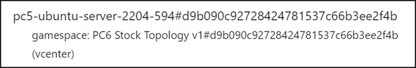

**Search** matches the VM name, the workspace or gamespace it belongs to, the host, or a pasted gamespace GUID. The tab shows at most 100 results; if it reaches that limit, refine the search term.

Use the table headers to sort by:

- **Machine Name:** The VM name.
- **Gamespace / Group:** The workspace or gamespace the VM belongs to, linked so you can open it, with its GUID underneath. Click the GUID to copy it.
- **State:** The VM's power state.
- **Host:** The hypervisor host the VM runs on.

#### "Orphaned" VMs

VMs labeled **Orphaned** in the **Gamespace / Group** column are VMs that still exist but are not associated with a workspace or gamespace. VMs can become orphaned when there is an error or disconnection from the hypervisor during TopoMojo's cleanup process. Orphaned VMs should be manually removed from the hypervisor.

To quickly identify orphaned VMs, search for "orphaned" in the Search field.

### Users Tab

The **Users** tab shows all TopoMojo users. You can create new users and assign users permissions here. To search for a user, enter the term into the **Search** field or filter by role (**admins**, **observers**, **creators**, **builders**), by **service accounts**, or by *scope*. Recall from [workspace Settings](#settings) that *audience* is a list of clients who can launch the workspace as a gamespace.

- **View ( <i class="fa-solid fa-list" aria-label="list-icon" role="img"></i> ):** Select **View** to see the properties for the user. Users with a service account client ID are marked **Service Account**.
- **Delete ( <i class="fa-solid fa-trash" aria-label="delete-icon" role="img"></i> ):** Deletes the user.

#### Roles

- **User:** No extra permissions in TopoMojo. This is the TopoMojo default.
- **Builder:** Can connect to [reserved networks](#persistentshared-networks) such as `bridge-net`.
- **Creator:** Same permissions as *builder* with additional permissions to bypass building limits such as the number of owned workspaces and workspace template limits.
- **Observer:** Allows a user to view and use the *Observe* tab for viewing gamespaces. The *scope* of the user (see below) limits access to gamespaces with a matching *audience*.
- **Admin:** Full administrative access to TopoMojo.
- **Disabled:** No permissions in TopoMojo.

Grant the *Creator* role to users who need to build workspaces and troubleshoot deployed gamespaces.

An administrator can configure TopoMojo to inherit user roles from the Identity Provider (IdP). For example, an IdP administrator can add roles like *administrator*, *builder*, or a custom role then configure TopoMojo to map those IdP roles to TopoMojo roles. Inheriting roles reduces the need for redundant setup if you're already managing user roles on the identity provider across multiple Crucible apps. See the [Helm deployment documentation](https://github.com/cmu-sei/helm-charts/tree/main/charts/topomojo#authentication-oidc) for more information on how to configure this setting.

TopoMojo reads IdP roles from these settings:

- **`Oidc__UserRolesClaimPath`:** Where in the access token to find role values. The default is `realm_access.roles`, which fits Keycloak realm roles. Set it to the string `null` to turn off IdP roles.
- **`Oidc__UserRolesClaimMap__<idp-role>`:** Maps an IdP role value to a TopoMojo role. For example, `Oidc__UserRolesClaimMap__builder = Builder` grants the Builder role to anyone whose token contains `builder`. The defaults map `administrator`, `builder`, `creator`, `observer`, and `user` to the matching TopoMojo roles. The IdP can't assign **Disabled**.

A user's *effective role* is the strongest of their TopoMojo role and every role mapped from their IdP roles. When the two differ, the user's row shows an **Identity Role / Effective Role** badge. Click it to see both assigned roles and which one wins. Disabling a user in TopoMojo blocks them regardless of IdP roles.

#### Create a New User

- **Name:** Enter a new user name here.
- **Scope:** A space-delimited list of administrator-defined groups the user belongs to. Administrators can define a *scope* with any name here. A user's scope determines which workspaces they have permission to deploy gamespaces from. Users can only deploy a gamespace from a workspace if the user has a *scope* that matches an *audience* defined in the workspace. See also: [Building a new workspace](#building-a-new-workspace).
- **Workspace Limit:** The maximum number of workspaces this user can manage.
- **Gamespace Limit:** The maximum number of concurrent active gamespaces allowed for this user.
- **Gamespace Max Duration:** The maximum amount of minutes allowed for a gamespace.
- **Gamespace Cleanup Grace time:** The number of minutes between gamespace expiration and when TopoMojo tears down the associated VMs.
- **Service Account Client Id:** Lets an OAuth client authenticate as this user with the client credentials flow, for automation. TopoMojo matches it against the `client_id` claim in the access token; `Oidc__ServiceAccountClientIdClaimType` changes the claim name, and setting it to the string `null` turns service accounts off. Give service accounts the **Observer** role at most; TopoMojo shows a warning on administrators that have a client ID.
- **Generate ApiKey:** Generate API keys for users to programmatically interact with the TopoMojo API without needing to log in interactively.

For regular users, TopoMojo may update **Name** from the identity token at sign-in.

TopoMojo creates users automatically the first time they sign in, with limits taken from these settings:

| Setting | Default | Effect |
| --- | --- | --- |
| `Core__DefaultWorkspaceLimit` | `0` | Workspaces a new user can create. `0` means none; users with the **Creator** role or above aren't limited. |
| `Core__DefaultTemplateLimit` | `3` | Template limit applied to each workspace created by a user below the **Creator** role. |
| `Core__DefaultGamespaceLimit` | `0` | Concurrent gamespaces for a new user. `0` means unlimited. The sample `appsettings.conf` shows `2`; the built-in default is `0`. |
| `Core__DefaultGamespaceMinutes` | `120` | Gamespace duration when neither the user's **Gamespace Max Duration** nor the workspace's **Duration** is set. |
| `Core__ReplicaLimit` | `5` | Maximum **Replicas** value on a template. |
| `Core__DefaultUserScope` | `everyone` | Scope added to every user. See [Settings](#settings). |

### Settings Tab

Upload a custom background image to change TopoMojo's theme. Wide images usually work best. Click **Clear background** to return to the default. You can also set the background in configuration with `Ui__Branding__BackgroundImageUrl`.

### Log Tab

The **Log** tab is useful from the admin point of view when trying to troubleshoot. The Log tab only shows errors here, not every log line. Click an entry to expand its stack trace, and click it again to collapse it. Use the copy button to copy an entry, for example into a bug report.
